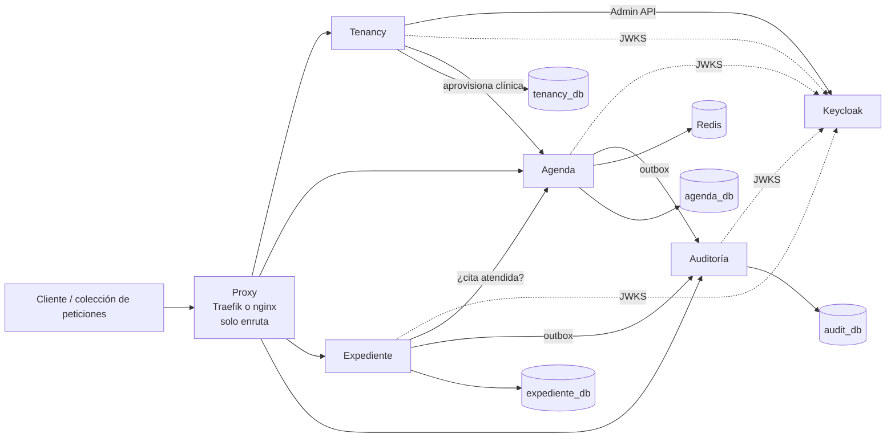

# MediCitas — Propuesta de arquitectura

> **Estado:** propuesta para discusión del grupo (no aprobada).
> **Alcance:** Etapa 1 (núcleo transaccional). Se señalan los puntos que preparan la Etapa 2.
> **Fecha:** 2026-11-09

---

## 1. Contexto

MediCitas es una plataforma SaaS multi-tenant de gestión de citas médicas: una empresa la vende a muchas clínicas y los datos de cada clínica permanecen estrictamente aislados.

El profesor indicó que, aunque un monolito es una opción válida, **prefiere por fines didácticos que el sistema se separe en microservicios**. Este documento evalúa varias formas de hacerlo y propone una.

La pregunta que guía todo el diseño es la del enunciado:

> Dos recepcionistas reservan el último espacio de la agenda exactamente al mismo tiempo. ¿Qué hace el sistema, por qué, y cómo se demuestra?

Cualquier separación en servicios debe dejar esa pregunta igual de fácil de responder y de demostrar que en un monolito.

---

## 2. Criterios de decisión

En orden de prioridad:

1. **Invariantes con transacciones locales.** I1–I4, I7 e I8 deben garantizarse dentro de una sola transacción de una sola base de datos. No es negociable.
2. **La reserva no depende de la red.** RF9 es la operación crítica; no debe fallar porque otro servicio esté caído.
3. **Aislamiento del dato más sensible.** La nota clínica (RF15) debe quedar detrás de credenciales que ningún otro servicio tenga.
4. **Bitácora atómica, protegida en el motor y consultable en un solo lugar** (RF18, RF19, I6).
5. **Costo y riesgo.** `docker compose up` debe funcionar siempre, sin intervención, y el alcance debe caber en el plazo.
6. **Valor didáctico y preparación para la Etapa 2** (plataforma distribuida y capa analítica).

**Regla de corte:** se separa donde no se rompe ninguna transacción que sostiene un invariante, y donde se gana aislamiento de datos sensibles.

---

## 3. Opciones evaluadas

| Opción | Invariantes locales | Reserva sin red | Notas aisladas | Bitácora | Costo | Didáctica / Etapa 2 |
|---|---|---|---|---|---|---|
| A. Monolito modular | ✓ | ✓ | ~ (mismo proceso) | ✓ | Bajo | Baja |
| B. 3 servicios: Tenancy · Agenda · Clínico (pacientes junto a las notas) | ✓ | ✗ | ✓ | ✓ | Medio | Media |
| C. 4 servicios con gateway propio y pacientes junto a las notas | ✓ | ✗ | ✓ | ~ | Medio-alto | Alta |
| **D. 4 servicios: Tenancy · Agenda · Expediente · Auditoría (pacientes en Agenda)** | ✓ | ✓ | ✓ | ✓ | Medio-alto | Alta |
| E. Grano fino (catálogo, disponibilidad, etc. por separado) | ✗ | ✗ | ✓ | ~ | Muy alto | Engañosa |

**Por qué se descartan las demás:**

- **E** separa piezas que deben decidirse en la misma transacción. Separar el catálogo rompe I4 (la duración de un servicio podría cambiar durante una reserva). Separar la disponibilidad rompe I7 e I8 (la invalidación dejaría de ocurrir junto al commit de la reserva). Es el antipatrón conocido como "monolito distribuido".
- **B y C** ponen a los pacientes junto a las notas. Eso obliga a la reserva a preguntarle a otro servicio si el paciente existe y es de la misma clínica, lo que vuelve dependiente de la red a la operación crítica y deja la protección de I5 en esa operación en manos de una llamada HTTP en lugar de una restricción de la BD. Además, la agenda del día (RF20) necesitaría pedir los nombres de los pacientes a otro servicio.
- **C**, además, propaga la clínica y el rol en encabezados desde un gateway propio. Si alguien llega directo a un servicio, puede inventarlos y romper I5. Corresponde al nivel "Regular" de la rúbrica de identidad ("la clínica llega en la petición sin verificarse").
- **A** es técnicamente impecable, pero va contra la preferencia del profesor y deja todo el trabajo distribuido para la Etapa 2. **Es la alternativa de respaldo** si el plazo no alcanza (ver §12).

**Decisión propuesta: opción D.**

---

## 4. Vista general



Las cuatro bases de datos viven en **una sola instancia de PostgreSQL**, cada una con sus propios roles. Keycloak, Redis y Postgres son infraestructura, no servicios de dominio.

---

## 5. Servicios

### 5.1 Tenancy — la recepción del edificio

**Qué hace:** da de alta clínicas y cuentas de usuario, asigna roles y da de baja usuarios. Es el único servicio con alcance sobre todas las clínicas y el único que guarda las credenciales de administración de Keycloak.

**Requisitos:** RF1, RF2.

**Datos:** `clinics` (identificador, nombre, zona horaria, estado) y `users` (subject de Keycloak, clínica, rol, estado).

**Responsabilidades clave:**
- Al crear o modificar un usuario, escribe en Keycloak el **rol de realm** y el atributo **`clinic_id`**, que viajan firmados en el token. Así **Keycloak es la única fuente de verdad del rol**, y se elimina el riesgo de que el rol de la BD y el del token diverjan.
- La baja lógica deshabilita al usuario en Keycloak (no puede obtener tokens nuevos) y lo marca como inactivo en la BD.
- Al crear una clínica la **aprovisiona** en Agenda (identificador y zona horaria).

**Nota sobre RF1:** crear una clínica toca tres sistemas (la BD de Tenancy, Keycloak y Agenda) sin transacción común. Se resuelve como una saga pequeña: la clínica se registra en estado `provisioning`, cada paso es idempotente y se reintenta, y al terminar pasa a `active`. Es una operación poco frecuente y de administración, así que la consistencia eventual aquí es aceptable.

### 5.2 Agenda — el corazón

**Qué hace:** todo el trabajo diario de la clínica: catálogo, profesionales, horarios, bloqueos, pacientes, disponibilidad, citas y su ciclo de vida.

**Requisitos:** RF3–RF14, RF16, RF20, RF21. Produce eventos de auditoría de RF18 para los datos de contacto de pacientes.

**Datos:** `services`, `practitioners`, `practitioner_services`, `schedules`, `blocks`, `patients`, `appointments`, `clinic_settings` (zona horaria aprovisionada por Tenancy) y `audit_outbox`. Además usa Redis para la caché de disponibilidad.

**Por qué es el servicio grande:** la reserva necesita leer el horario, los bloqueos, la duración del servicio, la asociación profesional–servicio y las citas vigentes, y escribir, todo en una sola transacción. Tener los pacientes aquí permite que I2 e I5 se garanticen en la reserva con restricciones del motor, sin llamadas de red.

### 5.3 Expediente — el archivo bajo llave

**Qué hace:** guarda las notas clínicas. Solo el profesional que atendió una cita puede escribir su nota, y antes de aceptarla consulta a Agenda que la cita está atendida y que la atendió él.

**Requisitos:** RF15. Produce eventos de auditoría de RF18 para las notas.

**Datos:** `clinical_notes` y `audit_outbox`.

**Por qué está aparte:** si alguien compromete Agenda, que es el servicio con más rutas y más superficie de ataque, no tiene credenciales para leer las notas. En la Etapa 2 es un candidato natural para el almacén documental.

### 5.4 Auditoría — la cámara de seguridad

**Qué hace:** recibe los registros de acceso que producen Agenda y Expediente, los guarda de forma append-only y permite consultarlos al administrador de la clínica.

**Requisitos:** RF19 (consulta). Es el almacén central de RF18.

**Datos:** `audit_log`. El rol de la aplicación solo tiene `INSERT` y `SELECT`, y un trigger rechaza cualquier `UPDATE` o `DELETE`.

**Por qué está aparte:**
1. Tiene **dos productores**. Sin un servicio central, RF19 tendría que mezclar dos fuentes con filtros y paginación.
2. **Quien es vigilado no guarda las grabaciones.** Si alguien compromete Expediente, no puede borrar el registro de lo que hizo, porque está en otra base de datos con otras credenciales.

---

## 6. Asignación de requisitos

| RF | Servicio | | RF | Servicio |
|---|---|---|---|---|
| RF1 | Tenancy | | RF12 | Agenda |
| RF2 | Tenancy | | RF13 | Agenda |
| RF3 | Agenda | | RF14 | Agenda |
| RF4 | Agenda | | RF15 | Expediente |
| RF5 | Agenda | | RF16 | Agenda |
| RF6 | Agenda | | RF17 | Todos (biblioteca compartida) + Keycloak |
| RF7 | Agenda | | RF18 | Agenda y Expediente (producen) → Auditoría (almacena) |
| RF8 | Agenda | | RF19 | Auditoría |
| RF9 | Agenda | | RF20 | Agenda |
| RF10 | Agenda | | RF21 | Agenda |
| RF11 | Agenda | | | |

---

## 7. Cómo se garantiza cada invariante

| Invariante | Mecanismo propuesto | Dónde |
|---|---|---|
| **I1** Profesional sin citas solapadas | Restricción de exclusión `EXCLUDE USING gist (practitioner_id WITH =, tstzrange(starts_at, ends_at) WITH &&) WHERE (status = 'reservada')` (requiere `btree_gist`). Una reserva concurrente recibe `23P01` → 409 "espacio ya tomado". | Agenda (motor) |
| **I2** Paciente sin citas solapadas | Restricción de exclusión equivalente sobre `patient_id`. | Agenda (motor) |
| **I3** Dentro del horario y fuera de bloqueos | Validación dentro de la transacción de reserva, con bloqueo de la fila del profesional (`SELECT … FOR UPDATE`), que también toman la creación de bloqueos y los cambios de horario. Así un bloqueo no se cuela entre la validación y la inserción. | Agenda |
| **I4** Duración fijada por el servicio | `ends_at` se calcula a partir de la duración del servicio dentro del mismo `INSERT`; un trigger impide modificarlo después. | Agenda (motor) |
| **I5** Aislamiento entre clínicas | `clinic_id` tomado del token firmado, nunca de la petición; claves foráneas compuestas `(clinic_id, id)` en todas las relaciones; base de datos por servicio; RLS como segunda capa (módulo del grupo de tres). | Todos |
| **I6** Bitácora inmodificable | Rol de la app con solo `INSERT`/`SELECT` y trigger que rechaza `UPDATE`/`DELETE`, tanto en `audit_log` como en cada `audit_outbox`. | Auditoría, Agenda, Expediente |
| **I7** Cancelar o reprogramar libera de inmediato | El cambio de estado excluye la cita de la restricción de exclusión en la misma transacción; la caché se invalida tras el commit. | Agenda |
| **I8** La caché no contradice la BD | Invalidación después del commit, con un número de versión por agenda (ver §9.3). | Agenda + Redis |

El nivel de aislamiento propuesto es **READ COMMITTED** (el que usa Postgres por defecto), porque I1 e I2 los garantiza la restricción de exclusión y no la lectura previa. La decisión final, la comparación con SERIALIZABLE y el manejo de deadlocks (orden de bloqueo consistente y reintento ante `40P01`/`40001`) quedan a cargo del responsable de concurrencia.

---

## 8. Identidad y autorización

- **Keycloak** emite tokens OIDC con el rol (rol de realm) y la clínica (atributo `clinic_id` mediante un *protocol mapper*). En Keycloak 26 el atributo debe declararse en el *user profile* del realm, porque los atributos no declarados están desactivados por defecto.
- **Cada servicio valida el JWT por su cuenta** (firma contra JWKS, emisor, expiración y destinatario) con una biblioteca compartida. **Nunca** se confía en encabezados como `X-Clinic-Id`.
- **Tokens de vida corta (5 minutos).** Una baja o un cambio de rol surte efecto como máximo al vencer el token; los inicios de sesión nuevos se bloquean al instante. Es un compromiso documentado.
- **La autorización tiene dos niveles:**
  1. Por ruta: el rol del token debe tener el permiso (401 sin token válido, 403 sin el rol).
  2. Por recurso, dentro del servicio: reglas como "solo los propios" o "solo de citas propias" se revisan con un `Actor` (usuario, clínica, rol y, si aplica, profesional) que recibe la capa de servicio.
- **Permisos según las filas de la matriz**, por ejemplo `appointments:book`, `appointments:outcome`, `patients:read`, `patients:write`, `notes:write_own`, `audit:read`.
- **Llamadas entre servicios:**
  - Si la llamada nace de un usuario (Expediente → Agenda), se **reenvía su token**, para que el servicio llamado aplique el aislamiento con la identidad real.
  - Si no hay usuario (relay de auditoría, aprovisionamiento), se usa un token de **client credentials** con un client confidencial por servicio.

---

## 9. Datos y consistencia

### 9.1 Topología

- Una instancia de PostgreSQL con **una base de datos por servicio**. Postgres no permite `JOIN` entre bases distintas, así que la frontera entre servicios la impone el motor.
- Cada servicio tiene un rol dueño (para migraciones) y roles de aplicación con privilegios mínimos.
- **Roles alineados con la matriz (propuesta):** dentro de cada transacción, el servicio ejecuta `SET LOCAL ROLE` al rol de BD que corresponde al rol del usuario (por ejemplo `agenda_reception`, `agenda_practitioner`, `agenda_admin`). Así la matriz de permisos también se aplica en el motor, y el mecanismo se reutiliza para RLS.

### 9.2 Modelo de consistencia

| Interacción | Tipo | Consistencia | Por qué es aceptable |
|---|---|---|---|
| Reservar, reprogramar, cancelar | Local | Fuerte (ACID) | Restricciones de exclusión en una sola BD |
| Disponibilidad desde caché | Local + Redis | Fuerte para la siguiente lectura | Invalidación tras el commit, versionada |
| Nota → cita atendida | Síncrona (Expediente → Agenda) | Fuerte | "Atendida" es un estado final (RF13): una vez verificada no puede cambiar, así que no hay carrera |
| Registro de auditoría en origen | Local, en la misma transacción | Fuerte (atómica) | Se escribe en `audit_outbox` junto con la acción auditada |
| Bitácora central (RF19) | Asíncrona (outbox → Auditoría) | Eventual (segundos) | Entrega garantizada y sin duplicados |
| Clínica y rol en el token | Keycloak | Hasta la vida del token | Token de 5 minutos; Keycloak bloquea logins nuevos al instante |
| Alta de clínica (RF1) | Saga en Tenancy | Eventual | Operación rara de administración, con pasos idempotentes |

### 9.3 Caché de disponibilidad (propuesta)

- Clave por profesional, fecha y servicio, que incluye un **número de versión de esa agenda**: `avail:{clinic}:{practitioner}:{date}:{service}:v{n}`.
- Tras el commit de cualquier cambio que afecte esa agenda (reserva, cancelación, reprogramación, bloqueo, cambio de horario), se incrementa la versión (`INCR`).
- Un lector obtiene la versión **antes** de leer la BD y guarda el resultado bajo esa versión. Si una reserva hace commit mientras tanto, la versión sube y el resultado viejo queda huérfano: nadie lo vuelve a leer. Esto evita la carrera clásica en que una lectura vieja se escribe en la caché después de invalidarla.
- Queda por definir qué hacer si Redis no responde durante la invalidación (por ejemplo, no servir desde la caché mientras no esté sano). Decisión del responsable de la caché.

### 9.4 Outbox de auditoría

- Agenda y Expediente escriben cada evento de auditoría en su tabla `audit_outbox` **en la misma transacción** que la lectura o escritura auditada. Con esto RF18 e I6 se cumplen en el origen aunque Auditoría esté caída.
- `audit_outbox` es append-only (solo `INSERT` para la app y un trigger que rechaza `UPDATE`/`DELETE`).
- Un *relay* (una goroutine dentro del mismo servicio) envía los eventos a Auditoría por HTTP, autenticado con client credentials.
- **El relay no modifica el outbox.** Registra lo entregado en una tabla aparte, `audit_outbox_delivered(event_id)`, y en cada ciclo toma los eventos que todavía no aparecen ahí. No se usa un cursor con el último id enviado: los ids de una secuencia pueden hacer commit fuera de orden y un cursor se saltaría eventos.
- Auditoría inserta con `ON CONFLICT (event_id) DO NOTHING`. La entrega es "al menos una vez" y el resultado es "exactamente una vez".
- En la Etapa 2, el mismo mecanismo puede alimentar la capa analítica.

---

## 10. Dependencias entre servicios

| Origen → destino | Para qué | Tipo | Si el destino no responde |
|---|---|---|---|
| Expediente → Agenda | Verificar que la cita está atendida y por quién (RF15) | HTTP síncrono, token del usuario | No se puede escribir la nota (503); el resto del sistema funciona |
| Tenancy → Agenda | Aprovisionar la clínica (RF1) | HTTP síncrono, client credentials | La clínica queda en `provisioning` y se reintenta |
| Tenancy → Keycloak | Crear usuarios, roles y atributo de clínica | Admin API | El alta queda pendiente y se reintenta |
| Agenda → Tenancy | Validar que el usuario de un profesional existe y tiene ese rol (RF4) | HTTP síncrono | No se puede registrar el profesional; las reservas no se afectan |
| Agenda, Expediente → Auditoría | Entregar eventos de RF18 | Outbox + relay | Los eventos esperan en el outbox; nada se pierde |
| Todos → Keycloak | Llaves públicas (JWKS) | HTTP, en caché | Se usan las llaves en caché hasta que vencen |

**La reserva (RF9) no depende de ningún otro servicio.**

---

## 11. Aspectos transversales

### 11.1 Estructura del repositorio

Un solo repositorio y un solo módulo de Go, con un binario por servicio:

```
cmd/
  tenancy/  agenda/  expediente/  audit/
internal/
  platform/          # compartido: config, logging, errores → HTTP, health
    auth/            # validación JWT, Actor, permisos
    db/              # TxManager (aislamiento, SET LOCAL ROLE/tenant, reintentos, after-commit)
    outbox/          # escritura y relay
    svcclient/       # cliente HTTP entre servicios (token relay / client credentials)
  tenancy/           # dominio + handlers + repositorio
  agenda/            # catálogo, horarios, pacientes, citas, disponibilidad, caché
  expediente/
  audit/
migrations/
  tenancy/  agenda/  expediente/  audit/
seed/
keycloak/realm-export.json
deploy/proxy/        # configuración de Traefik o nginx
docs/
  design.md  adr/  api/   # OpenAPI por servicio
```

Un solo Dockerfile con un argumento de build (`SERVICE=agenda`) produce las cuatro imágenes.

### 11.2 Docker Compose

`proxy`, `keycloak`, `postgres`, `db-init` (crea bases y roles; debe ser idempotente, porque `docker-entrypoint-initdb.d` solo se ejecuta con el volumen vacío), un job de migración por servicio, `seed`, `redis`, `tenancy`, `agenda`, `expediente`, `audit`.

- Cada servicio espera con `depends_on` a que terminen las migraciones y la semilla, y a que Postgres y Keycloak estén sanos (con `KC_HEALTH_ENABLED=true`).
- Solo el proxy y Keycloak publican puertos al host.
- `KC_HOSTNAME` fija el emisor de los tokens, para que coincida sin importar desde dónde se piden.

### 11.3 Observabilidad y robustez

- Logs estructurados (`log/slog`) con un **ID de petición** que se propaga entre servicios, para seguir una reserva de punta a punta.
- `/health` (proceso vivo) y `/ready` (BD y dependencias disponibles) en cada servicio.
- Timeouts en el servidor HTTP y en las llamadas salientes, contexto propagado y apagado ordenado.
- Los errores internos se registran siempre; al cliente solo le llega un mensaje genérico.

### 11.4 Contrato y documentación

- Especificación OpenAPI por servicio en `docs/api/`, más una colección de peticiones versionada.
- Registros de decisión breves en `docs/adr/` (este documento es el primero).

### 11.5 Pruebas

| Tipo | Qué demuestra |
|---|---|
| Unitarias | Cálculo de disponibilidad (función pura), máquina de estados, traducción de roles a permisos |
| Integración (contra la pila de Compose) | Todos los RF a través del proxy, con tokens reales de Keycloak |
| Carrera | N clientes liberados a la vez sobre el último espacio → exactamente un 201 y el resto 409; se repite muchas veces |
| Fuga entre clínicas | En cada servicio: identificadores de otra clínica en rutas, cuerpos y filtros de listados → 404/403 |
| Caché | Consultar, reservar y volver a consultar: el espacio ya no aparece (I8) |
| Outbox | Reenvío del mismo evento → un solo registro; Auditoría caída → los eventos se entregan al volver |
| Un test por invariante | Trazabilidad RF ↔ prueba ↔ invariante en el informe de pruebas |

---

## 12. Riesgos y mitigaciones

| Riesgo | Mitigación |
|---|---|
| El plazo no alcanza para cuatro servicios | Respaldo: opción A (monolito modular) **con las mismas cuatro fronteras**: un módulo por servicio, una base de datos por módulo y comunicación por interfaces. La separación pasa a la Etapa 2 sin rediseño. Decidir ya, no a mitad de camino. |
| `docker compose up` frágil con más contenedores | Healthchecks y `depends_on` estrictos; jobs idempotentes; probarlo desde un clon limpio antes de cada avance. |
| La lógica compartida se duplica | Paquetes en `internal/platform/` usados por los cuatro binarios. |
| Silos de conocimiento antes de la defensa individual | Cada PR lo revisa alguien que no es su dueño; las tres preguntas garantizadas las prepara todo el grupo. |
| El profesor esperaba otra cosa | Confirmar por Discord que la cantidad de contenedores no choca con el criterio de aceptación 1. |

---

## 13. Distribución sugerida del trabajo

Es una sugerencia para discutir:

| Persona | Responsabilidad principal |
|---|---|
| P1 | `internal/platform` (auth, TxManager, outbox, cliente entre servicios), Tenancy, Auditoría, Expediente, infraestructura de pruebas, Compose y proxy |
| P2 | Modelo de datos de Agenda (incluidos pacientes), RF5, RF6, RF14, RF16, multi-tenancy y RLS, semilla |
| P3 | Reserva y ciclo de vida de la cita (RF9–RF13), disponibilidad y caché (RF7, RF8, I8), prueba de carrera, RF20, RF21 |

El esquema de `appointments` (y sus restricciones de exclusión) lo diseñan **P2 y P3 juntos** antes de escribir código, porque ese esquema *es* la estrategia de concurrencia.

---

## 14. Preparación para la Etapa 2

- La separación en servicios ya existe; la Etapa 2 la distribuye y endurece (TLS, despliegue) en lugar de crearla.
- Expediente es un candidato natural para el almacén documental.
- El mecanismo de outbox puede alimentar la capa analítica sin acoplarla al motor transaccional.

---

## 15. Preguntas abiertas

1. ¿Confirma el profesor que una pila con más de cuatro contenedores es aceptable para el criterio de aceptación 1?
2. ¿Cuál es la fecha de entrega acordada? Determina si se implementa D o el respaldo A.
3. ¿Se adopta `SET LOCAL ROLE` por rol de usuario para alinear los roles de BD con la matriz (§9.1)?
4. Nivel de aislamiento y estrategia de deadlocks: decisión final del responsable de concurrencia.
5. Comportamiento de la caché cuando Redis no responde (§9.3).
