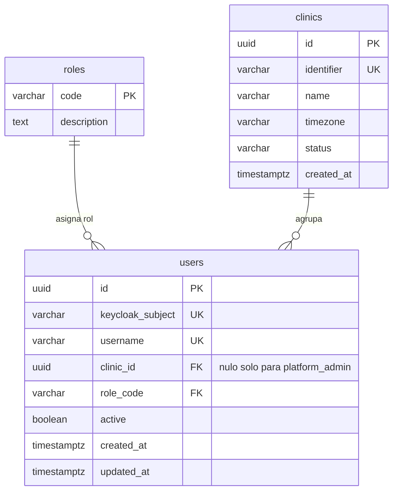
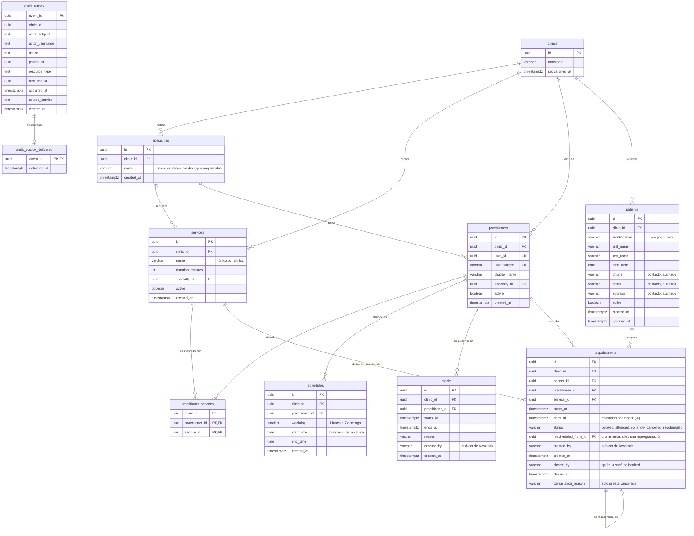
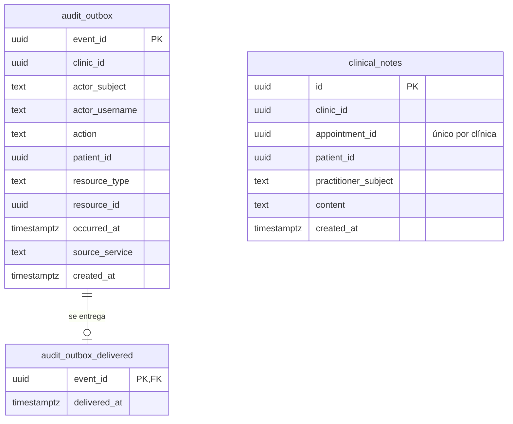
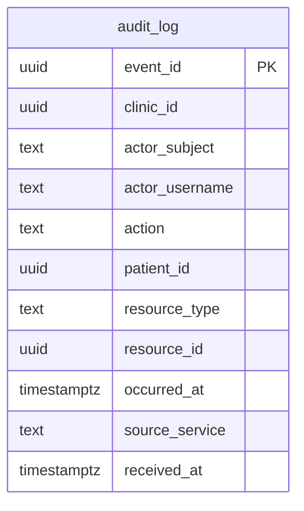
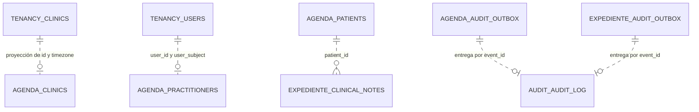
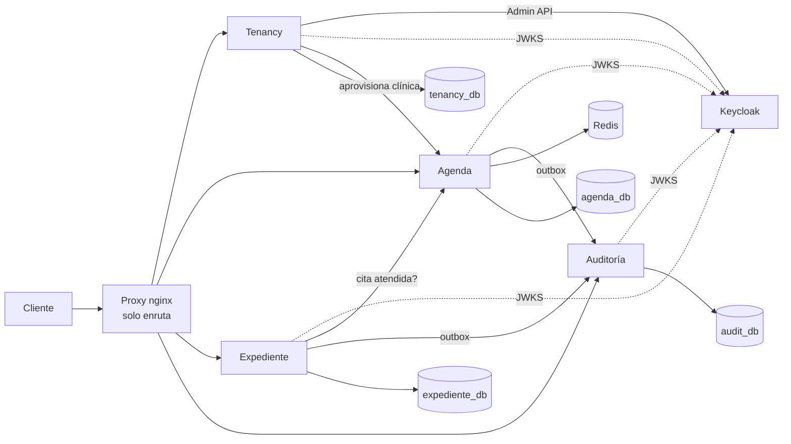

# Documento de diseño

Este documento reúne el diseño de MediCitas: el modelo de datos, la estrategia de multi-tenancy, la arquitectura de servicios y la seguridad de la base de datos. Cada decisión viene con las alternativas que se consideraron y lo que se sacrificó.

**Estado:** los horarios, los bloqueos y las citas de Agenda ya están implementados. Sus decisiones de concurrencia y de caché están en la sección 5; en la sección 3 queda el resumen.

| Sección | Estado |
|---|---|
| 1. Modelo de datos: diagramas ER, 3FN y desnormalizaciones | Completo para las tablas existentes |
| 1.5 Índices por especialidad: medición | Completo |
| 1.6 Diccionario de datos | Completo |
| 2. Multi-tenancy: comparación y decisión | Completo, con RLS implementado en `agenda_db` y medido |
| 3. Arquitectura de servicios | Completo |
| 4. Seguridad de la base de datos y auditoría | Completo |
| 5. Concurrencia y caché: pregunta rectora, nivel de aislamiento, candados, disponibilidad y caché | Completo |

---

## 1. Modelo de datos

### 1.1 Visión general

El sistema usa una instancia de PostgreSQL con **una base de datos por servicio**. Postgres no permite `JOIN` entre bases, así que la frontera entre servicios la impone el motor. Las referencias entre bases son **lógicas** (un identificador sin llave foránea) y se validan en la aplicación.

| Base | Servicio | Tablas | Migraciones |
|---|---|---|---|
| `tenancy_db` | Tenancy | `roles`, `clinics`, `users` | `migrations/tenancy` |
| `agenda_db` | Agenda | `clinics`, `specialties`, `services`, `practitioners`, `practitioner_services`, `patients`, `schedules`, `blocks`, `appointments`, `audit_outbox`, `audit_outbox_delivered` | `migrations/agenda` |
| `expediente_db` | Expediente | `clinical_notes`, `audit_outbox`, `audit_outbox_delivered` | `migrations/expediente` |
| `audit_db` | Auditoría | `audit_log` | `migrations/audit` |

Convenciones comunes a todo el modelo:

- Los identificadores son `UUID` generados por la base (`gen_random_uuid()`).
- Las fechas con hora son `TIMESTAMPTZ`.
- Toda tabla de datos de una clínica lleva la columna `clinic_id`.
- En Agenda, toda relación entre tablas de una clínica es una **llave foránea compuesta** `(clinic_id, id)`. Así el motor rechaza una fila que apunte a otra clínica (I5).

### 1.2 Diagramas entidad-relación

Se muestra un diagrama por base y uno con las referencias lógicas entre bases. Las líneas punteadas son referencias sin llave foránea.

#### Tenancy



#### Agenda



Las llaves foráneas hacia `specialties`, `services`, `practitioners` y `patients`, entre `practitioner_services` y sus padres, y las de `schedules`, `blocks` y `appointments` son **compuestas** `(clinic_id, id)`. El diagrama las dibuja como una sola línea para mantenerlo legible.

#### Expediente



#### Auditoría



#### Referencias lógicas entre bases



Ninguna de estas relaciones tiene llave foránea, porque cada extremo vive en una base distinta. La coherencia se mantiene así:

- **Clínicas:** Tenancy crea la clínica y la proyecta a Agenda con una saga, con compensación si falla.
- **Profesionales:** Agenda consulta a Tenancy, con el token del usuario, antes de registrar un profesional.
- **Notas clínicas:** Expediente verifica la cita con Agenda antes de aceptar una nota. Esa verificación espera a que existan las citas.
- **Auditoría:** el relay entrega los eventos de forma idempotente por `event_id`.

### 1.3 Normalización hasta la tercera forma normal

#### Criterio

| Forma | Qué exige | Cómo se comprobó |
|---|---|---|
| **1FN** | Valores atómicos, sin grupos repetidos | Ninguna columna guarda listas. Las relaciones muchos a muchos tienen su propia tabla (`practitioner_services`) |
| **2FN** | Ningún atributo depende de solo una parte de la clave | Se revisó cada tabla con clave compuesta. Hay una excepción deliberada (ver 1.4) |
| **3FN** | Ningún atributo no clave depende de otro atributo no clave | Se escribieron las dependencias funcionales de cada tabla y se buscó si un atributo no clave determina a otro |

#### Caso trabajado: las especialidades

Es el paso de normalización que se hizo sobre el esquema original (migración `0003_specialties`).

**Antes.** `services` y `practitioners` guardaban `specialty` como texto libre:

```
services(id, clinic_id, name, duration_minutes, specialty, ...)
practitioners(id, clinic_id, display_name, specialty, ...)
```

El nombre de una especialidad es un hecho sobre la especialidad, no sobre el servicio ni sobre el profesional. Guardarlo en cada fila provoca anomalías:

| Anomalía | Ejemplo |
|---|---|
| **Actualización** | Corregir "Pediatria" a "Pediatría" obliga a modificar todas las filas de `services` y `practitioners` que lo repiten. Si se olvida una, queda inconsistente |
| **Inserción** | No existe una especialidad sin un servicio o profesional que la use |
| **Borrado** | Eliminar el único servicio de una especialidad hace desaparecer la especialidad |
| **Inconsistencia** | "Medicina general" y "medicina general" se tratan como dos especialidades distintas |

Esto es una **dependencia transitiva**: `servicio → especialidad → nombre de la especialidad`. Viola la 3FN.

**Después.** El nombre vive una sola vez en su propia tabla y las demás referencian su identificador:

```
specialties(id, clinic_id, name)              -- único por (clinic_id, lower(name))
services(id, clinic_id, ..., specialty_id)    -- FK compuesta (clinic_id, specialty_id)
practitioners(id, clinic_id, ..., specialty_id)
```

Qué se ganó:

- El nombre depende de la clave de `specialties`, y nada más.
- La unicidad sin distinguir mayúsculas elimina la inconsistencia.
- La comparación "el servicio requiere la especialidad del profesional" (RF4) se hace por identificador y no por texto.
- La llave foránea compuesta impide asignar la especialidad de otra clínica (I5).

Qué se sacrificó: las consultas de lectura necesitan un `JOIN` con `specialties` para mostrar el nombre. Es un costo pequeño, porque la unión es por clave y está cubierta por índice.

#### Análisis por tabla

La columna "Determinantes" lista las claves candidatas. Todas las demás columnas dependen únicamente de ellas.

**Tenancy**

| Tabla | Determinantes | Veredicto |
|---|---|---|
| `roles` | `code` | 3FN. La descripción depende solo del código. Separar la tabla evita repetir la descripción en cada usuario |
| `clinics` | `id`, `identifier` | 3FN |
| `users` | `id`, `keycloak_subject`, `username` | 3FN. `role_code` referencia a `roles`, en lugar de guardar la descripción del rol |

**Agenda**

| Tabla | Determinantes | Veredicto |
|---|---|---|
| `clinics` | `id` | 3FN. Es una proyección de la clínica de Tenancy (ver 1.4) |
| `specialties` | `id`, `(clinic_id, lower(name))` | 3FN |
| `services` | `id`, `(clinic_id, name)` | 3FN. La especialidad se referencia por `specialty_id` |
| `practitioners` | `id`, `user_id`, `user_subject` | 3FN. `user_id` y `user_subject` son claves candidatas entre sí, no una dependencia transitiva |
| `practitioner_services` | `(practitioner_id, service_id)` | 1FN y 3FN, con una **excepción de 2FN deliberada**: `clinic_id` depende solo de una parte de la clave (ver 1.4) |
| `patients` | `id`, `(clinic_id, identification)` | 3FN. El contacto (teléfono, correo, dirección) depende del paciente, no de otro atributo |
| `schedules` | `id` | 3FN. Cada fila es un bloque de atención; una restricción de exclusión impide que dos bloques del mismo profesional se solapen en un día |
| `blocks` | `id` | 3FN |
| `appointments` | `id` | 3FN, con una **excepción deliberada**: `ends_at` se deriva de `starts_at` y de la duración del servicio (ver 1.4) |
| `audit_outbox` | `event_id` | Excepción deliberada: `resource_type` y `source_service` se derivan de `action` (ver 1.4) |
| `audit_outbox_delivered` | `event_id` | 3FN |

**Expediente**

| Tabla | Determinantes | Veredicto |
|---|---|---|
| `clinical_notes` | `id`, `(clinic_id, appointment_id)` | Excepción deliberada: `patient_id` y `practitioner_subject` se derivan de la cita (ver 1.4) |
| `audit_outbox`, `audit_outbox_delivered` | Igual que en Agenda | Igual que en Agenda |

**Auditoría**

| Tabla | Determinantes | Veredicto |
|---|---|---|
| `audit_log` | `event_id` | Excepción deliberada: `resource_type` y `source_service` se derivan de `action` (ver 1.4) |

### 1.4 Desnormalizaciones deliberadas

El enunciado exige documentar cada desnormalización con su motivo. Estas son todas las que existen:

| # | Dónde | Qué se repite o se deriva | Motivo | Cómo se mantiene consistente |
|---|---|---|---|---|
| 1 | `practitioner_services.clinic_id` | Depende de `practitioner_id` (y de `service_id`), o sea de parte de la clave. Viola 2FN | Permite que las dos llaves foráneas sean **compuestas** `(clinic_id, id)`, y así el motor impide asociar un profesional con un servicio de otra clínica (I5) | Las dos llaves foráneas compuestas obligan a que el `clinic_id` coincida con el del profesional y con el del servicio |
| 2 | `agenda.clinics.timezone` | Copia del `timezone` de `tenancy.clinics` | Agenda necesita la zona horaria de cada clínica para calcular horarios, disponibilidad y agenda del día sin llamar a Tenancy en cada consulta | Tenancy es la fuente de verdad y la proyecta a Agenda al crear la clínica (saga con compensación). Esa ruta interna es idempotente |
| 3 | `tenancy.users.role_code` | Copia del rol de realm de Keycloak | Tenancy muestra y filtra usuarios por rol sin consultar a Keycloak | Keycloak es la fuente de verdad. Tenancy lo actualiza después de Keycloak en cada cambio de rol |
| 4 | `clinical_notes.patient_id` y `practitioner_subject` | Se derivan de la cita (`appointment_id`), que vive en Agenda | Expediente debe autorizar ("solo el profesional de la cita") y auditar sin llamar a Agenda en cada lectura. Los datos se toman del contexto verificado de la cita en el momento de escribir la nota | Se escriben una sola vez, junto con la nota, y la nota no se modifica (el rol de la aplicación solo tiene `SELECT` e `INSERT`) |
| 5 | `audit_log` y `audit_outbox`: `resource_type` y `source_service` | Se derivan de `action` | La bitácora es un registro **inmutable** de hechos. Guardar el valor evita una tabla de acciones y un `JOIN` en cada consulta de auditoría | La migración fija con `CHECK` qué combinaciones son válidas, y el contrato del evento lo asigna el escritor del outbox |
| 6 | `audit_log.actor_username` y `audit_outbox.actor_username` | Copia del nombre de usuario en el momento del evento | La bitácora conserva quién actuó aunque el usuario cambie o se dé de baja. La identidad estable es `actor_subject` | Es una instantánea de solo escritura, que el trigger de inmutabilidad impide modificar |
| 7 | `audit_outbox.patient_id`, `clinic_id` (sin llave foránea) | Referencia lógica a `patients` | El outbox es append-only y no debe depender de que el paciente exista ni bloquear su escritura. En Expediente el mismo campo referencia a una base distinta | La aplicación escribe el evento dentro de la misma transacción que la operación sobre el paciente |
| 8 | `appointments.ends_at` | Se deriva de `starts_at` y de `services.duration_minutes` | Las restricciones de exclusión de I1 e I2 necesitan el intervalo completo en la propia fila. Además fija la duración en el momento de reservar: si después cambia la duración del servicio, las citas ya reservadas conservan la suya | Un trigger lo calcula al insertar e ignora el valor que envíe la aplicación; otro trigger impide modificarlo después (I4) |

> **Nota.** Los motivos de las filas 3 a 7 se leyeron de las migraciones y de los comentarios del código de Tenancy, Expediente y Auditoría, que no son de quien escribe este documento. Conviene confirmarlos con quien los diseñó antes de defenderlos.

### 1.5 Índices por especialidad: medición

La migración `0003` crea dos índices sobre `(clinic_id, specialty_id)`: `idx_services_specialty` en `services` e `idx_practitioners_specialty` en `practitioners`. Su comentario dice que sirven para buscar por especialidad y para validar que un servicio requiere la especialidad del profesional (RF4). Se midió si eso es cierto.

**Cómo se midió.** En `agenda_db`, dentro de una transacción que se deshace al terminar, con `EXPLAIN (ANALYZE)` y `ANALYZE` previo. El conjunto de datos de la primera consulta es de una clínica con 5.000 servicios y 1.500 profesionales; el del borrado, 100 clínicas con 53.191 servicios y 20.570 profesionales. Cada plan se comparó con y sin los índices (`DROP INDEX` dentro de la misma transacción). Es una sola ejecución por caso, así que sirve para el orden de magnitud y no para una cifra exacta.

| Consulta | Con los índices | Sin los índices | Qué muestra |
|---|---|---|---|
| Listar el catálogo de una clínica (`ListServices`), 5.000 servicios | 10,0 ms, recorrido secuencial y `Hash Join` | 10,2 ms, el mismo plan | No usa el índice: lee toda la clínica, y para eso el recorrido secuencial es lo mejor |
| Asociar servicios a un profesional (`insertPractitionerServices`) | 0,190 ms | 0,093 ms | No ayuda: `id = ANY(...)` es mucho más selectivo, y el plan sin el índice usa `services_clinic_id_unique` y es más rápido |
| Verificación de `services_specialty_fk` al borrar una especialidad | 0,29 ms | 1,48 ms | El índice la acelera unas 5 veces |
| Verificación de `practitioners_specialty_fk` al borrar una especialidad | 0,22 ms | 0,72 ms | El índice la acelera unas 3 veces |

**Decisión: se conservan, pero por otra razón de la que decía el comentario.** Son los índices del lado que referencia en las llaves foráneas compuestas hacia `specialties`. PostgreSQL indexa el lado referenciado (la clave de `specialties`), no el que referencia. Sin estos índices, borrar o cambiar una especialidad obliga a recorrer todos los servicios y profesionales de la tabla para comprobar `ON DELETE RESTRICT`, y esa comprobación crece con el tamaño de las tablas. Cuestan 16 kB cada uno con los datos de ejemplo, y mantenerlos en cada alta es despreciable.

**Lo que no justifican.** Ninguna consulta de la aplicación se apoya hoy en ellos. La afirmación de la migración sobre buscar por especialidad y validar RF4 no se confirma con la medición, y ninguna ruta borra especialidades todavía. Si el grupo prefiere un esquema sin índices que ninguna ruta usa, se pueden quitar con una migración nueva sin perder funcionalidad. Se conservan porque el borrado es la única operación del esquema que los necesita para ser barata.

> **Advertencia sobre los contadores.** `pg_stat_user_indexes` muestra cientos de usos de ambos índices después de correr las pruebas. Esa cifra no prueba que sean útiles: con tablas de decenas de filas, el optimizador elige el plan casi sin diferencia de costo, y cualquier plan es igual de rápido.

### 1.6 Diccionario de datos

Describe todas las tablas de las cuatro bases, columna por columna. Se armó leyendo el esquema real de PostgreSQL (migraciones `0001` a `0009` de Agenda, `0001` de Tenancy y Auditoría, `0001` y `0002` de Expediente), no de memoria. La columna *Nulo* dice si admite `NULL`.

**Convenciones**

- Todo `id` es `uuid` y lo genera la base con `gen_random_uuid()`, salvo que se diga otra cosa.
- **PK** es llave primaria, **UQ** restricción única y **FK** llave foránea. Una FK compuesta `(clinic_id, id)` es la que impide, en el motor, apuntar a una fila de otra clínica (I5, sección 2).
- Las fechas con hora son `timestamptz`: guardan un instante absoluto. Los horarios semanales (`schedules`) son la excepción: guardan hora de pared en la zona de la clínica.
- Las nueve tablas de Agenda con datos de clínica tienen además una política de RLS por `clinic_id` (sección 2.7), que no se repite en cada tabla. Los `audit_outbox` quedan fuera a propósito.

**Entidades que pide el enunciado, y dónde viven**

| Entidad | Tabla | Base |
|---|---|---|
| Clínica | `clinics` | `tenancy_db` (fuente de verdad). Agenda guarda una proyección |
| Usuario | `users` | `tenancy_db` |
| Rol | `roles` | `tenancy_db` |
| Profesional | `practitioners` y `practitioner_services` | `agenda_db` |
| Servicio | `services` (y `specialties`) | `agenda_db` |
| Horario de atención | `schedules` | `agenda_db` |
| Bloqueo de agenda | `blocks` | `agenda_db` |
| Paciente | `patients` | `agenda_db` |
| Cita | `appointments` | `agenda_db` |
| Nota clínica | `clinical_notes` | `expediente_db` |
| Registro de auditoría | `audit_log` (y los `audit_outbox` de origen) | `audit_db` |

Las credenciales no están en ninguna tabla: las administra Keycloak. La entidad usuario guarda solo el identificador que Keycloak emite, la clínica y el rol.

#### `tenancy_db`

**`clinics`**: una clínica de la plataforma (RF1).

| Columna | Tipo | Nulo | Descripción |
|---|---|---|---|
| `id` | `uuid` | NO | **PK.** Identificador de la clínica. Es el valor que viaja firmado en el claim `clinic_id` del token |
| `identifier` | `varchar(64)` | NO | **UQ.** Identificador legible, por ejemplo `clinic-demo`. Solo minúsculas, dígitos y guiones, y empieza por letra o dígito (`CHECK`) |
| `name` | `varchar(160)` | NO | Nombre de la clínica |
| `timezone` | `varchar(64)` | NO | Zona horaria IANA, por ejemplo `America/Costa_Rica`. Agenda la usa para interpretar horarios y días |
| `status` | `varchar(16)` | NO | `provisioning` mientras corre la saga de alta (proyección en Agenda y administrador en Keycloak) y `active` al terminar. Por omisión, `provisioning` |
| `created_at` | `timestamptz` | NO | Cuándo se creó. Por omisión, `now()` |

**`roles`**: los cuatro roles del sistema.

| Columna | Tipo | Nulo | Descripción |
|---|---|---|---|
| `code` | `varchar(32)` | NO | **PK.** `platform_admin`, `clinic_admin`, `reception` o `practitioner` |
| `description` | `text` | NO | Descripción del rol |

**`users`**: la identidad de cada usuario y a qué clínica pertenece (RF2).

| Columna | Tipo | Nulo | Descripción |
|---|---|---|---|
| `id` | `uuid` | NO | **PK.** Identificador local del usuario |
| `keycloak_subject` | `varchar(64)` | NO | **UQ.** El `sub` que Keycloak emite, que identifica al usuario en su token |
| `username` | `varchar(64)` | NO | **UQ.** Nombre de usuario |
| `clinic_id` | `uuid` | SÍ | **FK** a `clinics(id)` (`ON DELETE RESTRICT`). `NULL` solo para `platform_admin` |
| `role_code` | `varchar(32)` | NO | **FK** a `roles(code)`. Copia del rol de realm de Keycloak, que es la fuente de verdad. Se actualiza después de Keycloak en cada cambio de rol |
| `active` | `boolean` | NO | `false` tras la baja lógica. Por omisión, `true` |
| `created_at` | `timestamptz` | NO | Alta del registro |
| `updated_at` | `timestamptz` | NO | Última modificación |

Restricción `users_tenant_role_check`: `platform_admin` exige `clinic_id` nulo, y cualquier otro rol exige `clinic_id`. Así un usuario de clínica nunca queda sin clínica.

#### `agenda_db`

**`clinics`**: proyección local de las clínicas. Tenancy es la fuente de verdad y la provisiona aquí (ver la desnormalización 2 en 1.4).

| Columna | Tipo | Nulo | Descripción |
|---|---|---|---|
| `id` | `uuid` | NO | **PK.** El mismo `id` de `tenancy_db.clinics`. No tiene valor por omisión: lo entrega Tenancy |
| `timezone` | `varchar(64)` | NO | Copia de la zona horaria de la clínica |
| `provisioned_at` | `timestamptz` | NO | Cuándo se provisionó la clínica en Agenda |

**`specialties`**: especialidades médicas de cada clínica (ver el caso trabajado en 1.3).

| Columna | Tipo | Nulo | Descripción |
|---|---|---|---|
| `id` | `uuid` | NO | **PK** |
| `clinic_id` | `uuid` | NO | **FK** a `clinics(id)`. **UQ** `(clinic_id, id)`, para que otras tablas la referencien de forma compuesta |
| `name` | `varchar(120)` | NO | Nombre, por ejemplo «Medicina general». Único dentro de la clínica sin distinguir mayúsculas, con un índice único sobre `(clinic_id, lower(name))` |
| `created_at` | `timestamptz` | NO | Alta |

**`services`**: tipos de consulta de la clínica y su duración (RF3).

| Columna | Tipo | Nulo | Descripción |
|---|---|---|---|
| `id` | `uuid` | NO | **PK** |
| `clinic_id` | `uuid` | NO | **FK** a `clinics(id)`. **UQ** `(clinic_id, id)` |
| `name` | `varchar(120)` | NO | Nombre del servicio. **UQ** `(clinic_id, name)` |
| `duration_minutes` | `integer` | NO | Duración en minutos, de 1 a 480 (`CHECK`). Determina el tamaño del espacio que ocupa una cita (I4) |
| `specialty_id` | `uuid` | NO | **FK** compuesta `(clinic_id, specialty_id)` a `specialties` (`RESTRICT`). La especialidad que el servicio requiere |
| `active` | `boolean` | NO | `false` cuando el servicio se retira del catálogo. Por omisión, `true` |
| `created_at` | `timestamptz` | NO | Alta |

**`practitioners`**: profesionales de salud de la clínica (RF4).

| Columna | Tipo | Nulo | Descripción |
|---|---|---|---|
| `id` | `uuid` | NO | **PK** |
| `clinic_id` | `uuid` | NO | **FK** a `clinics(id)`. **UQ** `(clinic_id, id)` |
| `user_id` | `uuid` | NO | **UQ.** El usuario de Tenancy que es este profesional. Sin FK, porque vive en otra base: se valida al registrar al profesional |
| `user_subject` | `varchar(64)` | NO | **UQ.** El `sub` de Keycloak del usuario. Sirve para reconocer a un profesional por su token |
| `display_name` | `varchar(160)` | NO | Nombre con el que se muestra, por ejemplo «Dra. Ana Prueba» |
| `specialty_id` | `uuid` | NO | **FK** compuesta `(clinic_id, specialty_id)` a `specialties` (`RESTRICT`) |
| `active` | `boolean` | NO | `false` si el usuario deja de ser profesional o se da de baja. Por omisión, `true` |
| `created_at` | `timestamptz` | NO | Alta |

**`practitioner_services`**: qué servicios atiende cada profesional (tabla de unión). Lleva `clinic_id` a propósito, para que las dos llaves foráneas sean compuestas (desnormalización 1 de 1.4).

| Columna | Tipo | Nulo | Descripción |
|---|---|---|---|
| `clinic_id` | `uuid` | NO | Clínica de ambos lados |
| `practitioner_id` | `uuid` | NO | **PK** con `service_id`. **FK** compuesta a `practitioners` (`ON DELETE CASCADE`) |
| `service_id` | `uuid` | NO | **PK** con `practitioner_id`. **FK** compuesta a `services` (`RESTRICT`) |

**`patients`**: pacientes de la clínica (RF14). El paciente no es usuario del sistema. `phone`, `email` y `address` son datos de contacto: toda lectura o escritura se audita (RF18).

| Columna | Tipo | Nulo | Descripción |
|---|---|---|---|
| `id` | `uuid` | NO | **PK** |
| `clinic_id` | `uuid` | NO | **FK** a `clinics(id)`. **UQ** `(clinic_id, id)` |
| `identification` | `varchar(40)` | NO | Cédula o documento. **UQ** `(clinic_id, identification)`: única dentro de la clínica, y puede repetirse entre clínicas |
| `first_name` | `varchar(80)` | NO | Nombre. No puede quedar vacío |
| `last_name` | `varchar(120)` | NO | Apellidos. No puede quedar vacío |
| `birth_date` | `date` | NO | Fecha de nacimiento, desde 1900 (`CHECK`). Que no sea futura lo valida la aplicación, porque depende de la fecha actual |
| `phone` | `varchar(30)` | SÍ | Teléfono. Dato de contacto |
| `email` | `varchar(254)` | SÍ | Correo. Dato de contacto |
| `address` | `varchar(300)` | SÍ | Dirección. Dato de contacto |
| `active` | `boolean` | NO | Por omisión, `true` |
| `created_at` | `timestamptz` | NO | Alta |
| `updated_at` | `timestamptz` | NO | Última modificación |

**`schedules`**: horario de atención semanal y vigente de cada profesional (RF5). Cada fila es un bloque en un día de la semana, así que una jornada partida son dos filas. No guarda historia.

| Columna | Tipo | Nulo | Descripción |
|---|---|---|---|
| `id` | `uuid` | NO | **PK.** **UQ** `(clinic_id, id)` |
| `clinic_id` | `uuid` | NO | Clínica del profesional |
| `practitioner_id` | `uuid` | NO | **FK** compuesta a `practitioners` (`ON DELETE CASCADE`) |
| `weekday` | `smallint` | NO | Día de la semana según ISO 8601: 1 es lunes y 7 es domingo (`CHECK`) |
| `start_time` | `time` | NO | Hora de inicio, en hora de pared de la zona de la clínica |
| `end_time` | `time` | NO | Hora de fin, mayor que la de inicio. Un bloque no cruza la medianoche |
| `created_at` | `timestamptz` | NO | Alta |

Restricción de exclusión `schedules_no_overlap`: dos bloques del mismo profesional no se solapan en un mismo día. El rango es `[inicio, fin)`, así que 08:00–12:00 y 12:00–17:00 son válidos.

**`blocks`**: bloqueos de agenda por vacaciones o permisos (RF6). Retiran la disponibilidad pero no cancelan citas.

| Columna | Tipo | Nulo | Descripción |
|---|---|---|---|
| `id` | `uuid` | NO | **PK.** **UQ** `(clinic_id, id)` |
| `clinic_id` | `uuid` | NO | Clínica del profesional |
| `practitioner_id` | `uuid` | NO | **FK** compuesta a `practitioners` (`ON DELETE CASCADE`) |
| `starts_at` | `timestamptz` | NO | Inicio del bloqueo, como instante absoluto |
| `ends_at` | `timestamptz` | NO | Fin del bloqueo, posterior al inicio (`CHECK`) |
| `reason` | `varchar(200)` | NO | Motivo, por ejemplo «Vacaciones». No puede quedar vacío |
| `created_by` | `varchar(64)` | NO | Subject de Keycloak de quien lo registró: el administrador o el propio profesional |
| `created_at` | `timestamptz` | NO | Alta |

Dos bloqueos del mismo profesional pueden solaparse. No hay restricción contra `appointments`: las citas que caen dentro se listan como conflictos.

**`appointments`**: citas y su ciclo de vida (RF9 a RF13). Solo `status = 'booked'` ocupa espacio en la agenda.

| Columna | Tipo | Nulo | Descripción |
|---|---|---|---|
| `id` | `uuid` | NO | **PK.** **UQ** `(clinic_id, id)` |
| `clinic_id` | `uuid` | NO | Clínica de la cita |
| `patient_id` | `uuid` | NO | **FK** compuesta a `patients` (`RESTRICT`) |
| `practitioner_id` | `uuid` | NO | **FK** compuesta a `practitioners` (`RESTRICT`) |
| `service_id` | `uuid` | NO | **FK** compuesta a `services` (`RESTRICT`). No se referencia `practitioner_services`: esa asociación se puede quitar después y la cita debe seguir existiendo |
| `starts_at` | `timestamptz` | NO | Inicio de la cita |
| `ends_at` | `timestamptz` | NO | Fin de la cita. Lo calcula un trigger a partir de `starts_at` y la duración del servicio, y el valor que envíe la aplicación se ignora (I4) |
| `status` | `varchar(16)` | NO | `booked` (vigente), `attended`, `no_show`, `cancelled` o `rescheduled` (los cuatro finales). Por omisión, `booked` |
| `rescheduled_from_id` | `uuid` | SÍ | **FK** compuesta a `appointments` y **UQ**. En la cita nueva de una reprogramación, apunta a la anterior. Una cita se reprograma a lo sumo una vez |
| `created_by` | `varchar(64)` | NO | Subject de Keycloak de quien reservó |
| `created_at` | `timestamptz` | NO | Cuándo se reservó |
| `closed_by` | `varchar(64)` | SÍ | Subject de quien la cerró. `NULL` mientras está `booked` |
| `closed_at` | `timestamptz` | SÍ | Cuándo se cerró. `NULL` mientras está `booked`. Para `attended` y `no_show` no puede ser anterior a `starts_at` (RF12) |
| `cancellation_reason` | `varchar(300)` | SÍ | Motivo de la cancelación. Obligatorio si `cancelled` y prohibido en los demás estados (RF11) |

Reglas del motor sobre esta tabla:

- **I1:** restricción de exclusión `appointments_practitioner_no_overlap`. Un profesional no tiene dos citas `booked` con intervalos que se solapan.
- **I2:** restricción de exclusión `appointments_patient_no_overlap`, equivalente para el paciente.
- **Coherencia del cierre:** `appointments_closed_consistent` exige `closed_by` y `closed_at` si y solo si la cita ya no está `booked`.
- **Trigger `appointments_set_ends_at`** (antes de insertar): fija `ends_at` según la duración del servicio (I4).
- **Trigger `appointments_guard_update`** (antes de actualizar): después de creada, de una cita solo cambian su estado y los datos de cierre, y una cita en estado final no puede cambiar (RF13).

**`audit_outbox`**: cola de eventos de auditoría de Agenda (RF18). Es idéntica a la de Expediente, y se describe en la sección siguiente.

#### `expediente_db`

**`clinical_notes`**: notas clínicas (RF15). Es el registro sensible del sistema y por eso vive aislada de las demás bases. Hay una nota por cita.

| Columna | Tipo | Nulo | Descripción |
|---|---|---|---|
| `id` | `uuid` | NO | **PK** |
| `clinic_id` | `uuid` | NO | Clínica de la nota. Sin FK: la clínica vive en otra base. Sale del token, nunca de la petición |
| `appointment_id` | `uuid` | NO | La cita a la que corresponde. Sin FK: vive en Agenda. Expediente la verifica con Agenda antes de insertar. **UQ** `(clinic_id, appointment_id)`: una nota por cita |
| `patient_id` | `uuid` | NO | Paciente de la cita. Sin FK. Se toma del contexto verificado de la cita, no de quien escribe |
| `practitioner_subject` | `text` | NO | Subject de Keycloak del profesional que atendió la cita y escribió la nota. Solo él puede leerla. No puede quedar vacío |
| `content` | `text` | NO | Texto de la nota. No puede quedar vacío |
| `created_at` | `timestamptz` | NO | Cuándo se escribió |

La aplicación solo tiene `SELECT` e `INSERT` sobre esta tabla: una nota no se modifica ni se borra (desnormalización 4 de 1.4).

**`audit_outbox`** y **`audit_outbox_delivered`**: ver la sección siguiente.

#### `audit_db`

**`audit_log`**: bitácora central de auditoría (RF18 y RF19). Recibe los eventos de Agenda y Expediente. **Solo admite inserciones** (I6): `audit_app` no tiene privilegios para modificarla y un trigger (`audit_log_immutable`) rechaza `UPDATE` y `DELETE` incluso al dueño.

| Columna | Tipo | Nulo | Descripción |
|---|---|---|---|
| `event_id` | `uuid` | NO | **PK.** Identificador del evento, que genera el servicio de origen. Hace la entrega idempotente: reenviar un evento no crea otra fila |
| `clinic_id` | `uuid` | NO | Clínica donde ocurrió. Un administrador solo consulta la suya |
| `actor_subject` | `text` | NO | Subject de Keycloak de quien actuó. Es la identidad estable |
| `actor_username` | `text` | NO | Nombre de usuario en ese momento. Es una instantánea: se conserva aunque el usuario cambie o se dé de baja (desnormalización 6 de 1.4) |
| `action` | `text` | NO | Qué se hizo: `patient_contact.read`, `patient_contact.write`, `clinical_note.read` o `clinical_note.write` (`CHECK`) |
| `patient_id` | `uuid` | NO | Paciente sobre el que se actuó |
| `resource_type` | `text` | NO | `patient_contact` o `clinical_note`. Se deriva de `action` (desnormalización 5 de 1.4) |
| `resource_id` | `uuid` | NO | Identificador del recurso: el paciente, o la nota clínica |
| `occurred_at` | `timestamptz` | NO | Cuándo ocurrió en el servicio de origen |
| `source_service` | `text` | NO | `agenda` o `expediente`. Qué servicio produjo el evento |
| `received_at` | `timestamptz` | NO | Cuándo lo guardó Auditoría. Por omisión, `now()` |

Los eventos llevan solo identificadores, nunca los valores de contacto ni el contenido de las notas.

**`audit_outbox`** (existe en `agenda_db` y en `expediente_db`): cola de eventos pendientes de entregar a Auditoría, o ya entregados. Cada evento se escribe aquí en la misma transacción que la operación auditada, y un *relay* lo entrega después. Solo admite inserciones (I6, trigger `audit_outbox_immutable`).

| Columna | Tipo | Nulo | Descripción |
|---|---|---|---|
| `event_id` | `uuid` | NO | **PK.** El mismo identificador que tendrá en `audit_log` |
| `clinic_id`, `actor_subject`, `actor_username`, `patient_id`, `resource_id`, `occurred_at` | | NO | Los mismos campos que `audit_log`. `patient_id` y `clinic_id` no tienen FK a propósito: el outbox no debe bloquearse si el paciente no existe (desnormalización 7 de 1.4) |
| `action` | `text` | NO | En Agenda: `patient_contact.read` o `patient_contact.write`. En Expediente: `clinical_note.read` o `clinical_note.write` (`CHECK`) |
| `resource_type` | `text` | NO | En Agenda, `patient_contact`. En Expediente, `clinical_note` |
| `source_service` | `text` | NO | En Agenda, `agenda`. En Expediente, `expediente` |
| `created_at` | `timestamptz` | NO | Cuándo se escribió el evento. Por omisión, `now()` |

**`audit_outbox_delivered`** (también en las dos bases): anota qué eventos ya se entregaron. Existe aparte para no tener que modificar el outbox, que es append-only.

| Columna | Tipo | Nulo | Descripción |
|---|---|---|---|
| `event_id` | `uuid` | NO | **PK** y **FK** a `audit_outbox(event_id)` (`ON DELETE RESTRICT`) |
| `delivered_at` | `timestamptz` | NO | Cuándo se entregó. Por omisión, `now()` |

Una consecuencia de esto: un evento está pendiente si su `event_id` está en `audit_outbox` y no está en `audit_outbox_delivered`.

---

## 2. Multi-tenancy

### 2.1 Qué debe lograr

El invariante **I5** dice: ningún dato de una clínica resulta accesible desde otra, por ninguna ruta ni combinación de parámetros. Es el corazón del producto, porque una fuga entre clínicas expone datos clínicos de personas.

Hay tres cosas que la estrategia debe resistir:

1. **Un error del programador:** una consulta que olvida filtrar por clínica.
2. **Un cliente malicioso:** quien manipula un identificador o un parámetro para alcanzar otra clínica.
3. **Un servicio comprometido:** un servicio que intenta leer datos que no son suyos.

### 2.2 Estrategias consideradas

| Estrategia | Cómo funciona |
|---|---|
| **A. Esquema (o base) por tenant** | Cada clínica tiene su propio esquema con sus propias tablas. Las consultas se dirigen al esquema de la clínica |
| **B. Columna discriminadora** | Todas las clínicas comparten las tablas, y cada fila lleva `clinic_id`. Cada consulta filtra por esa columna. Las llaves foráneas compuestas `(clinic_id, id)` impiden relacionar filas de clínicas distintas |
| **C. Row-Level Security (RLS)** | Todas las clínicas comparten las tablas, y el motor aplica una política que oculta las filas que no son de la clínica de la sesión, sin importar lo que diga la consulta |

#### Comparación

| Criterio | A. Esquema por tenant | B. Columna discriminadora | C. RLS |
|---|---|---|---|
| **Aislamiento ante un error de consulta** | Alto: una consulta sin filtro solo ve su esquema | **Bajo por sí solo:** una consulta sin `WHERE clinic_id` ve todo | Alto: el motor filtra aunque la consulta no lo haga |
| **Aislamiento relacional** (una fila no apunta a otra clínica) | Natural, porque no comparten tablas | Se logra con llaves foráneas compuestas | No lo da por sí solo, porque las políticas filtran lecturas y escrituras, pero no relaciones |
| **Costo operativo con muchas clínicas** | Alto: cada clínica nueva crea tablas, y cada migración se aplica N veces | **Bajo:** una migración sirve a todas | Bajo: una migración sirve a todas |
| **Alta de una clínica** | Crea un esquema y todas sus tablas | **Una fila** | Una fila |
| **Migraciones de esquema** | Hay que recorrer todos los esquemas y se puede dejar a unos desactualizados | **Una sola vez** | Una sola vez |
| **Consultas entre clínicas** (administración de plataforma, métricas) | Difíciles: hay que unir esquemas | **Simples** | Simples, con un rol que omite la política |
| **Conexiones y caché de planes** | Cada esquema tiene sus propios objetos, lo que reduce el aprovechamiento de planes y conexiones | **Aprovecha un solo conjunto de tablas** | Igual que B |
| **Riesgo de fuga por descuido del programador** | Bajo | **El más alto: depende de no olvidar el filtro en cada consulta** | Bajo |
| **Respaldo o restauración de una sola clínica** | **Fácil** | Difícil: hay que extraer sus filas | Difícil |
| **Rendimiento** | Bueno | Bueno, con índices que empiezan por `clinic_id` | Depende: el motor evalúa la política en cada fila. **Medido:** con el filtro explícito, de 0,02 a 0,06 ms más por consulta rápida y sin diferencia medible en las largas (sección 2.7) |

### 2.3 Decisión

**Mecanismo principal: B, columna discriminadora, reforzada con llaves foráneas compuestas y con el `clinic_id` tomado del token firmado.** **Como segunda estrategia, comparada y activable: C, RLS**, que se implementa en paralelo y se mide sobre las mismas consultas (módulo del grupo de tres).

Esta decisión es la misma que sostiene I5 en la sección 3.4. Aquí se justifica.

**Por qué B y no A**

- **El producto es SaaS con muchas clínicas.** Con esquema por tenant, cada clínica nueva obliga a crear y migrar un esquema completo. El alta de una clínica es una fila (RF1) y es parte de una saga que debe ser simple y con compensación.
- **Las migraciones se aplican una sola vez.** Con A habría que aplicarlas a cada esquema, y un fallo a mitad deja clínicas con versiones distintas.
- **La administración de plataforma necesita ver todas las clínicas** (listarlas y aprovisionarlas), algo que con A obliga a unir esquemas.
- **Las llaves foráneas compuestas dan el aislamiento relacional** que A daría de forma natural, y lo hacen dentro de un mismo conjunto de tablas.

**Por qué no basta B por sí solo**

El punto débil de B es que el aislamiento depende de que **cada consulta** incluya el filtro. Un solo `SELECT` sin `WHERE clinic_id` es una fuga. Por eso B se combina con otras capas (sección 2.4), y por eso existe RLS como segunda estrategia: lo que B deja en manos del programador, RLS lo deja en manos del motor.

**Por qué RLS como segunda estrategia y no como principal**

- Su rendimiento depende de las políticas y de los índices. Se midió (sección 2.7): con el filtro explícito el costo es mínimo, y sin él es mayor y más variable.
- No resuelve el aislamiento relacional entre tablas, que sí resuelven las llaves foráneas compuestas.
- Se implementó y se midió antes de decidir si pasa a ser obligatorio. El resultado está en la sección 2.7.

### 2.4 Cómo se implementa

La protección tiene varias capas independientes. Si una falla, las otras siguen:

| Capa | Mecanismo | Dónde |
|---|---|---|
| **1. Identidad** | El `clinic_id` viaja **firmado** en el token de Keycloak. Los servicios validan la firma, el emisor, la expiración y el destinatario | `internal/platform/auth` |
| **2. La clínica no viene de la petición** | La clínica sale del actor autenticado. Las entradas de las rutas no tienen un campo de clínica, y un `clinic_id` falsificado en el cuerpo o en la consulta se ignora | Servicios y *handlers* |
| **3. Filtro en cada consulta** | Toda consulta recibe la clínica del actor y filtra por `clinic_id` junto con el identificador del recurso | Almacenes (`store`) |
| **4. Transacción con clínica** | Toda operación corre dentro de `TxManager` con `ClinicID`, que fija `app.clinic_id` solo durante la transacción (`set_config` local). Así una conexión del pool nunca arrastra una clínica a otra petición, y las políticas de RLS pueden leerla | `internal/platform/database/tx.go` |
| **5. Restricciones del motor** | Llaves foráneas compuestas `(clinic_id, id)` en Agenda. El motor rechaza una fila que apunte a otra clínica | Migraciones |
| **6. Respuesta sin filtraciones** | Un recurso de otra clínica responde **404**, igual que uno inexistente, para no revelar que existe. Una violación de llave foránea se traduce también a 404 | `database.MapError` |
| **7. Una base por servicio** | Cada servicio solo puede conectarse a su propia base. Un servicio comprometido no alcanza las demás | Roles de PostgreSQL |
| **8. Roles sin atajos** | Los roles de la aplicación son `NOSUPERUSER` y `NOBYPASSRLS`. No pueden omitir las políticas de RLS | Sección 4 |
| **9. Row-Level Security en Agenda** | Una política por tabla en `agenda_db` deja ver y escribir solo las filas de la clínica de la transacción, aunque una consulta olvide el filtro. Sin clínica en la transacción no se ve ninguna fila (sección 2.7) | Migración `0009` |

### 2.5 Compromisos aceptados

| Compromiso | Qué se sacrifica | Por qué se acepta |
|---|---|---|
| **El filtro depende del programador** | Con B, una consulta sin filtro es una fuga | Se mitiga con las capas 3 a 6, con pruebas automáticas, y con RLS como segunda capa |
| **Respaldo por clínica** | No se puede restaurar fácilmente a una sola clínica | No es un requisito de esta etapa. Se extraerían sus filas por `clinic_id` |
| **`clinic_id` repetido en cada tabla hija** | Una columna más y llaves compuestas más anchas | Es el precio del aislamiento relacional (ver desnormalización 1 en 1.4) |
| **Un vecino ruidoso** | Una clínica muy activa comparte tablas e índices con las demás | Con el tamaño de esta etapa no es un riesgo real. Los índices empiezan por `clinic_id` |
| **Tokens de vida corta, no inmediatos** | Un cambio de clínica o de rol surte efecto al vencer el token (5 minutos) | Compromiso documentado en la sección 3.5 |

### 2.6 Cómo se demuestra I5

El enunciado pide demostrar I5 con pruebas automáticas que incluyan **intentos deliberados de fuga**. Hoy existen estas:

| Prueba | Qué intenta | Dónde |
|---|---|---|
| Aislamiento de pacientes | Leer o modificar un paciente de otra clínica, listarlo con `clinic_id` manipulado en el cuerpo y en la consulta, y buscar su identificación desde otra clínica | `cmd/agendacheck` (contra la pila real) |
| Aislamiento de la bitácora | Consultar desde otra clínica los eventos de auditoría de un paciente ajeno | `cmd/agendacheck` |
| La clínica sale del actor | Verificar que todas las operaciones de pacientes usan la clínica del actor, y que ninguna entrada tiene un campo de clínica | `internal/agenda/patients_test.go` (unitarias) |
| Aislamiento de servicios y usuarios | Leer servicios y usuarios de otra clínica, con la clínica falsificada en un encabezado | `cmd/p1check` |
| Aislamiento de citas, horarios y bloqueos | Leer o modificar citas, horarios, bloqueos y disponibilidad de otra clínica, también con un `clinic_id` falsificado en el cuerpo o en la consulta | `cmd/citascheck` |
| Aislamiento del historial, la agenda y el conteo | Ver el historial de un paciente, la agenda de un profesional o los conteos de otra clínica, con parámetros manipulados | `cmd/agendacheck` |
| Fronteras entre bases | Conectarse con las credenciales de un servicio a la base de otro | `db-security-test` |
| Row-Level Security | Con el rol real de la aplicación, leer sin ningún filtro de clínica: sin clínica en la sesión no se ve nada, y con una clínica solo sus filas, en las nueve tablas. Insertar, mover o modificar filas de otra clínica | `rls-test` (contra la base real) |
| Matriz de las tres clínicas | Desde cada clínica, leer y modificar servicios, profesionales, pacientes, historiales, agendas, usuarios y notas clínicas de las otras dos, con `clinic_id` y `X-Clinic-Id` manipulados. Después comprueba que nada cambió | `cmd/leakcheck` (contra la pila real) |
| Listados | Que los listados de usuarios, servicios, profesionales, pacientes y bitácora de cada clínica no traigan nada de otra, con parámetros manipulados | `cmd/leakcheck` |
| Alta con la clínica falsificada | Crear un usuario pidiendo otra clínica en el cuerpo, la consulta y la cabecera: queda en la del token | `cmd/leakcheck` |
| Notas clínicas | Leer una nota ajena: de otra clínica, de otro profesional de la misma clínica o con un rol sin permiso | `cmd/leakcheck` |
| Bitácora | Que cada administrador solo vea eventos de su clínica, y que filtrar por un paciente o usuario de otra no devuelva nada | `cmd/leakcheck` |
| Rutas internas | Alcanzar `/internal/...` por el proxy, ni siquiera con un token de administrador | `cmd/leakcheck` |

`cmd/leakcheck` cubre los cuatro servicios: Tenancy, Agenda, Expediente y Auditoría. Empieza con una prueba de control que lee los recursos propios de cada clínica, para que un 404 de las demás pruebas signifique aislamiento y no una ruta inexistente.

### 2.7 RLS en `agenda_db` y mediciones

RLS es la segunda estrategia de la sección 2.3, y ya está implementada en `agenda_db` (migración `0009`). Funciona **junto** con el filtro `clinic_id` de cada consulta y no lo reemplaza.

**Qué se implementó**

- **Una política por tabla**, llamada `clinic_isolation`, en las nueve tablas con datos de clínica: `clinics`, `specialties`, `services`, `practitioners`, `practitioner_services`, `patients`, `schedules`, `blocks` y `appointments`.
- **La misma regla para leer y escribir.** `USING` limita lo que se ve, se actualiza o se borra, y `WITH CHECK` impide insertar o mover filas hacia otra clínica.
- **La clínica sale de `app.clinic_id`**, que `TxManager` fija con `set_config` local en cada transacción. La función `current_clinic_id()` la lee.
- **Falla hacia el lado seguro.** Sin `app.clinic_id`, `current_clinic_id()` es `NULL` y no se ve ninguna fila.
- **Quién queda sujeto.** Los roles de la aplicación (`agenda_app` y `agenda_readonly`) son `NOBYPASSRLS` y no son dueños de las tablas. `agenda_owner` sí es dueño y no pasa por las políticas, pero solo se usa para migrar. No se activó `FORCE ROW LEVEL SECURITY`, para que una migración de datos futura no deje de actualizar filas sin avisar. Las semillas corren como superusuario.

**Qué hubo que cambiar para que funcione.** Con RLS, una lectura que no fija la clínica no ve nada. Hasta entonces varias lecturas usaban el pool directo: cinco consultas del catálogo y unas veinte lecturas de horarios, disponibilidad y citas. Ahora todas corren dentro de `TxManager`, en una transacción de solo lectura con la clínica del token. Cuesta unos viajes más a la base por lectura (abrir la transacción, fijar la clínica y cerrarla), y a cambio la regla «toda consulta corre en `TxManager`» se cumple sin excepciones en las tablas con RLS.

**Las dos excepciones, y por qué**

| Excepción | Por qué | Cómo se acota |
|---|---|---|
| `audit_outbox` y `audit_outbox_delivered` no tienen RLS | Son la cola que el relay lee de **todas** las clínicas para entregar a Auditoría. El relay no actúa en nombre de una clínica, y con RLS no vería ningún evento | Son append-only (I6) y solo llevan identificadores, nunca datos de contacto |
| `practitioner_clinic_of_user(uuid)` es `SECURITY DEFINER` | Tenancy avisa a Agenda cuando un usuario deja de ser profesional. Esa llamada interna trae el id del usuario pero no su clínica, así que no hay con qué fijar `app.clinic_id` | Devuelve solo la clínica. Con ella, la escritura corre bajo las políticas como cualquier otra. Solo la puede ejecutar `agenda_app`, y tiene el `search_path` fijo |

**Cómo se demuestra.** `rls-test` (sección 3.8 de `pruebas.md`) usa el rol real de la aplicación y consultas **sin ningún filtro de clínica**. Además, las pruebas de integración de los cuatro servicios siguen pasando con RLS activo, lo que demuestra que la aplicación funciona bajo las políticas.

**Mediciones: filtro `clinic_id` (B) contra RLS (C)**

Se compararon tres estrategias sobre las mismas seis consultas de la aplicación. El script es `deploy/postgres/bench-rls.sql` y se puede repetir: corre en una transacción que se deshace.

| Estrategia | Qué es |
|---|---|
| **B** | Filtro `clinic_id` en la consulta, sin RLS (rol dueño de las tablas, que no pasa por las políticas) |
| **C1** | Filtro `clinic_id` **y** RLS, con el rol de la aplicación. Es lo que hace Agenda hoy |
| **C2** | Solo RLS, con el rol de la aplicación y **sin ningún filtro de clínica** en la consulta |

Los datos son 100 clínicas, con 30.000 pacientes, 2.000 profesionales y 200.000 citas, y se mide la clínica 50. Cada consulta se ejecuta entre 100 y 500 veces por ronda, planificándola de nuevo cada vez, en 5 rondas con el orden de las estrategias rotado. La ronda 1 calienta la caché y no cuenta. Se ejecutó el script completo **dos veces**. La tabla muestra la **mediana de las rondas 2 a 5**, en milisegundos por consulta.

| Consulta | Corrida 1: B / C1 / C2 | Corrida 2: B / C1 / C2 |
|---|---|---|
| Q1 leer un paciente por id | 0,116 / 0,139 / 0,131 | 0,133 / 0,152 / 0,164 |
| Q2 listado de pacientes (50, por nombre) | 0,214 / 0,256 / 0,251 | 0,245 / 0,309 / 0,315 |
| Q3 agenda del día de toda la clínica (RF20) | 1,924 / 1,843 / 3,155 | 2,253 / 2,089 / 2,392 |
| Q4 historial de un paciente (RF16) | 0,594 / 0,673 / 0,827 | 0,879 / 0,796 / 1,020 |
| Q5 conteo por estado en 10 días (RF21) | 2,934 / 2,922 / 3,046 | 4,607 / 3,559 / 3,824 |
| Q6 citas reservadas de un profesional en una franja (RF7) | 0,169 / 0,193 / 0,196 | 0,199 / 0,252 / 0,307 |
| **Suma de las seis** | **5,950 / 6,025 / 7,604** | **8,315 / 7,155 / 8,021** |

**Qué muestran los números**

- **El ruido de la máquina es mayor que las diferencias entre estrategias.** Con el mismo script, el total de B pasó de 5,950 a 8,315 ms entre las dos corridas, un 40 % de variación. En cambio C1 contra B da +1,3 % en la corrida 1 y -14 % en la 2. Con esta evidencia **no se puede afirmar que RLS haga más lenta una consulta larga**.
- **Hay un costo fijo pequeño y consistente.** En las tres consultas rápidas (Q1, Q2 y Q6), C1 fue más lento que B en las dos corridas, entre 0,02 y 0,06 ms por consulta (14 % a 27 %). Es el costo de evaluar la política y de planificar la consulta con ella. En las consultas largas (Q3, Q4 y Q5) la diferencia cambia de signo entre corridas y se pierde en el ruido.
- **Quitar el filtro explícito (C2) no gana nada.** C2 resultó igual o más lento que C1 en el total de las dos corridas (+26 % y +12 %), y fue el peor en Q3 y Q4 en la corrida 1. Una explicación posible, **que no se verificó**, es que con la política el planificador compara contra una expresión que depende de `app.clinic_id` y no contra una constante, por lo que estima peor cuántas filas devuelve.
- **El plan no cambia.** En el plan de Q3, la política de RLS aparece como una condición de índice más (`clinic_id = (NULLIF(current_setting('app.clinic_id', true), ''))::uuid`) sobre los mismos índices que usa B (`idx_appointments_practitioner_day` y `patients_clinic_id_unique`). En Q5 aparece igual, en la condición del recorrido de la tabla de citas. RLS no impide usar los índices que empiezan por `clinic_id`.

**Limitaciones de esta medición**

- **Es una sola máquina**, con PostgreSQL en Docker, con los datos en memoria y sin concurrencia. Mide el motor, no la red.
- **Las consultas duran décimas de milisegundo.** A esa escala el ruido es del mismo orden que las diferencias, por eso se reporta la mediana de cuatro rondas y se repitió la corrida. Aun así, una diferencia de 0,02 ms no es una conclusión.
- **No incluye el costo de la transacción.** Para que las políticas vean `app.clinic_id`, cada lectura corre ahora dentro de `TxManager`, con unos viajes más a la base por lectura. Eso se mide en la red y no dentro del motor, así que esta medición no lo cuenta.
- **No es una medición de carga.** No hay clientes concurrentes, y el volumen (200.000 citas) es el de decenas de clínicas, no el de un servicio con miles.

**Decisión**

1. **RLS queda activo y obligatorio en las nueve tablas con datos de clínica de `agenda_db`**, como segunda capa. Su costo con el filtro explícito, de 0,02 a 0,06 ms por consulta rápida y sin diferencia medible en las largas, no es un motivo para dejarlo opcional.
2. **No sustituye al filtro `clinic_id`.** Quitar el filtro y confiar solo en RLS (C2) no fue más rápido que C1 en el total de ninguna de las dos corridas, y además quita la defensa de la primera capa. B sigue siendo el mecanismo principal y C es la red de seguridad cuando una consulta olvida el filtro, que es justo el punto débil de B.
3. **Lo que cuesta RLS no es velocidad.** Cuesta que toda consulta corra en una transacción con la clínica fijada, lo que obligó a cambiar unas veinticinco lecturas. Cuesta también dos excepciones documentadas (`audit_outbox` y `practitioner_clinic_of_user`) y que una consulta que olvida la clínica devuelva cero filas en lugar de un error, lo cual es más difícil de depurar.
4. **No se extendió a los otros servicios.** RLS está solo en `agenda_db`, como pedía el módulo. Expediente sería el candidato natural, porque guarda las notas clínicas, pero no se hizo.

---

## 3. Arquitectura de servicios

### 3.1 Contexto y pregunta rectora

MediCitas es una plataforma SaaS multi-tenant: una empresa la vende a muchas clínicas y los datos de cada una permanecen aislados. El sistema se separa en servicios, y el diseño gira alrededor de la pregunta del enunciado:

> Dos recepcionistas reservan el último espacio de la agenda exactamente al mismo tiempo. ¿Qué hace el sistema, por qué, y cómo se demuestra?

Cualquier separación en servicios debe dejar esa pregunta igual de fácil de responder y de demostrar que en un monolito.

### 3.2 Criterios y opciones evaluadas

Criterios, en orden de prioridad:

1. **Invariantes con transacciones locales.** I1–I4, I7 e I8 deben garantizarse dentro de una sola transacción de una sola base de datos. No es negociable.
2. **La reserva no depende de la red.** RF9 es la operación crítica y no debe fallar porque otro servicio esté caído.
3. **Aislamiento del dato más sensible.** La nota clínica (RF15) debe quedar detrás de credenciales que ningún otro servicio tenga.
4. **Bitácora atómica, protegida en el motor y consultable en un solo lugar** (RF18, RF19, I6).
5. **Costo y riesgo.** `docker compose up` debe funcionar siempre, sin intervención.

**Regla de corte:** se separa donde no se rompe ninguna transacción que sostiene un invariante, y donde se gana aislamiento de datos sensibles.

| Opción | Invariantes locales | Reserva sin red | Notas aisladas | Bitácora | Costo |
|---|---|---|---|---|---|
| A. Monolito modular | ✓ | ✓ | ~ (mismo proceso) | ✓ | Bajo |
| B. 3 servicios: Tenancy, Agenda y Clínico (pacientes junto a las notas) | ✓ | ✗ | ✓ | ✓ | Medio |
| C. 4 servicios con gateway propio y pacientes junto a las notas | ✓ | ✗ | ✓ | ~ | Medio-alto |
| **D. 4 servicios: Tenancy, Agenda, Expediente y Auditoría (pacientes en Agenda)** | ✓ | ✓ | ✓ | ✓ | Medio-alto |
| E. Grano fino (catálogo, disponibilidad, etc. por separado) | ✗ | ✗ | ✓ | ~ | Muy alto |

**Por qué se descartan las demás:**

- **E** separa piezas que deben decidirse en la misma transacción. Separar el catálogo rompe I4 (la duración de un servicio podría cambiar durante una reserva). Separar la disponibilidad rompe I7 e I8 (la invalidación dejaría de ocurrir junto al commit de la reserva). Es el antipatrón conocido como "monolito distribuido".
- **B y C** ponen a los pacientes junto a las notas. Eso obliga a la reserva a preguntarle a otro servicio si el paciente existe y es de la misma clínica, lo que vuelve dependiente de la red a la operación crítica y deja la protección de I5 en esa operación en manos de una llamada HTTP en lugar de una restricción de la base de datos. Además, la agenda del día (RF20) tendría que pedir los nombres de los pacientes a otro servicio.
- **C**, además, propaga la clínica y el rol en encabezados desde un gateway propio. Si alguien llega directo a un servicio, puede inventarlos y romper I5.
- **A** es técnicamente impecable, pero deja todo el trabajo de separación para la etapa siguiente.

**Decisión: opción D.**

### 3.3 Servicios



Las cuatro bases viven en **una sola instancia de PostgreSQL**, cada una con sus propios roles. Keycloak, Redis y PostgreSQL son infraestructura, no servicios de dominio.

| Servicio | Qué hace | Requisitos | Por qué está aparte |
|---|---|---|---|
| **Tenancy** | Da de alta clínicas y usuarios, asigna roles y da de baja. Es el único con alcance sobre todas las clínicas y el único con las credenciales de administración de Keycloak | RF1, RF2 | Concentra el poder sobre todas las clínicas en un solo lugar |
| **Agenda** | Catálogo, profesionales, horarios, bloqueos, pacientes, disponibilidad, citas y su ciclo de vida | RF3–RF14, RF16, RF20, RF21 | Es el servicio grande a propósito: la reserva lee horario, bloqueos, duración, profesionales y citas, y escribe, todo en **una sola transacción**. Tener los pacientes aquí permite garantizar I2 e I5 con restricciones del motor, sin llamadas de red |
| **Expediente** | Guarda las notas clínicas. Solo el profesional que atendió la cita escribe su nota | RF15 | Si alguien compromete Agenda, que tiene más rutas y más superficie de ataque, no tiene credenciales para leer las notas |
| **Auditoría** | Recibe los registros de acceso de Agenda y Expediente, los guarda de forma append-only y los expone al administrador de la clínica | RF19 (y almacén central de RF18) | Tiene dos productores, y quien es vigilado no guarda las grabaciones: si alguien compromete Expediente, no puede borrar el registro de lo que hizo, porque está en otra base con otras credenciales |

Alta de una clínica (RF1): toca tres sistemas (la base de Tenancy, Keycloak y Agenda) sin transacción común. Se resuelve con una **saga pequeña**: la clínica se registra en estado `provisioning`, cada paso es idempotente y se reintenta, y al terminar pasa a `active`. Es una operación poco frecuente y de administración, así que la consistencia eventual es aceptable.

### 3.4 Cómo se garantiza cada invariante

| Invariante | Mecanismo | Dónde |
|---|---|---|
| **I1** Profesional sin citas solapadas | Restricción de exclusión `EXCLUDE USING gist (practitioner_id WITH =, tstzrange(starts_at, ends_at) WITH &&) WHERE (status = 'booked')` (requiere `btree_gist`). Una reserva concurrente recibe `23P01` y se responde 409 "espacio ya tomado" | Agenda (motor) |
| **I2** Paciente sin citas solapadas | Restricción de exclusión equivalente sobre `patient_id` | Agenda (motor) |
| **I3** Dentro del horario y fuera de bloqueos | Validación dentro de la transacción de reserva, con bloqueo de la fila del profesional (`SELECT … FOR UPDATE`), que también toman la creación de bloqueos y los cambios de horario. Así un bloqueo no se cuela entre la validación y la inserción | Agenda |
| **I4** Duración fijada por el servicio | `ends_at` se calcula a partir de la duración del servicio dentro del mismo `INSERT`, y un trigger impide modificarlo después | Agenda (motor) |
| **I5** Aislamiento entre clínicas | `clinic_id` tomado del token firmado, nunca de la petición. Llaves foráneas compuestas `(clinic_id, id)` en todas las relaciones. Una base por servicio. RLS como segunda capa (ver la sección 2) | Todos |
| **I6** Bitácora inmodificable | Rol de la aplicación con solo `INSERT` y `SELECT`, y un trigger que rechaza `UPDATE` y `DELETE`, tanto en `audit_log` como en cada `audit_outbox` (ver la sección 4.3) | Auditoría, Agenda, Expediente |
| **I7** Cancelar o reprogramar libera de inmediato | El cambio de estado excluye la cita de la restricción de exclusión en la misma transacción, y la versión de la agenda en la caché sube antes y después del commit | Agenda |
| **I8** La caché no contradice la base | Número de versión por agenda dentro de la clave, que sube antes y después del commit de cada cambio (ver la sección 3.7) | Agenda y Redis |

Todos estos mecanismos están implementados, con el nivel de aislamiento **READ COMMITTED** (el de PostgreSQL por defecto), porque I1 e I2 los garantiza la restricción de exclusión y no una lectura previa. La comparación con SERIALIZABLE, el manejo de deadlocks y las pruebas que lo demuestran están en la sección 5.

### 3.5 Identidad y autorización

- **Keycloak** emite tokens OIDC con el rol (rol de realm) y la clínica (atributo `clinic_id`, mediante un *protocol mapper*). En Keycloak 26 el atributo debe declararse en el *user profile* del realm, porque los atributos no declarados están desactivados por defecto.
- **Cada servicio valida el token por su cuenta**: firma contra las llaves públicas, emisor, expiración y destinatario. Nunca se confía en encabezados como `X-Clinic-Id`.
- **Tokens de vida corta (5 minutos).** Una baja o un cambio de rol surte efecto, como máximo, al vencer el token. Los inicios de sesión nuevos se bloquean al instante. Es un compromiso aceptado.
- **Dos niveles de autorización:**
  1. Por ruta: el rol del token debe tener el permiso (401 sin token válido, 403 sin el rol).
  2. Por recurso, dentro del servicio: reglas como "solo los propios" o "solo de citas propias" se revisan con un `Actor` (usuario, clínica y rol) que recibe la capa de servicio.
- **Llamadas entre servicios.** Si la llamada nace de un usuario (Expediente hacia Agenda), se reenvía su token, para que el servicio llamado aplique el aislamiento con la identidad real. Si no hay usuario (relay de auditoría, aprovisionamiento), se usa un token de *client credentials*, con un client confidencial por servicio.

### 3.6 Consistencia entre servicios

| Interacción | Tipo | Consistencia | Por qué es aceptable |
|---|---|---|---|
| Reservar, reprogramar, cancelar | Local | Fuerte (ACID) | Restricciones de exclusión en una sola base |
| Disponibilidad desde caché | Local y Redis | Fuerte para la siguiente lectura | Invalidación tras el commit, versionada |
| Nota hacia cita atendida | Síncrona (Expediente hacia Agenda) | Fuerte | "Atendida" es un estado final (RF13): una vez verificada no puede cambiar, así que no hay carrera |
| Registro de auditoría en origen | Local, en la misma transacción | Fuerte (atómica) | Se escribe en `audit_outbox` junto con la acción auditada |
| Bitácora central (RF19) | Asíncrona (outbox hacia Auditoría) | Eventual (segundos) | Entrega garantizada y sin duplicados |
| Clínica y rol en el token | Keycloak | Hasta la vida del token | Token de 5 minutos, y Keycloak bloquea los inicios de sesión nuevos al instante |
| Alta de clínica (RF1) | Saga en Tenancy | Eventual | Operación poco frecuente, con pasos idempotentes |

Dependencias entre servicios, y qué pasa si el destino no responde:

| Origen hacia destino | Para qué | Si el destino no responde |
|---|---|---|
| Expediente hacia Agenda | Verificar que la cita está atendida y por quién (RF15) | No se puede escribir la nota (503). El resto del sistema funciona |
| Tenancy hacia Agenda | Aprovisionar la clínica (RF1) | La clínica queda en `provisioning` y se reintenta |
| Tenancy hacia Keycloak | Crear usuarios, roles y atributo de clínica | El alta queda pendiente y se reintenta |
| Agenda hacia Tenancy | Validar que el usuario de un profesional existe y tiene ese rol (RF4) | No se puede registrar el profesional. Las reservas no se afectan |
| Agenda y Expediente hacia Auditoría | Entregar los eventos de RF18 | Los eventos esperan en el outbox y nada se pierde |
| Todos hacia Keycloak | Llaves públicas | Se usan las llaves en caché hasta que vencen |

**La reserva (RF9) no depende de ningún otro servicio.**

### 3.7 Caché de disponibilidad

La consulta de disponibilidad de un profesional (RF7) se sirve desde Redis. Cada agenda tiene un número de versión dentro de la clave de sus entradas, y todo cambio lo incrementa antes y después del commit (I8). Redis no es fuente de verdad: las reservas nunca dependen de la caché, y si Redis falla las consultas se calculan contra la base. El detalle, las alternativas descartadas y la medición están en la sección 5.6.

---

## 4. Seguridad de la base de datos y auditoría

### 4.1 Perfiles de PostgreSQL

Cada servicio tiene su propia base y tres perfiles de menor privilegio:

| Perfil | Para qué | DDL | SELECT | INSERT | UPDATE | DELETE |
|---|---|:-:|:-:|:-:|:-:|:-:|
| `<servicio>_owner` | Migraciones | sí | sí | sí | sí | sí |
| `<servicio>_app` | Identidad de la aplicación | no | sí | sí | sí | sí |
| `<servicio>_readonly` | Diagnóstico de solo lectura | no | sí | no | no | no |
| `audit_app` | Aplicación de Auditoría | no | sí | sí | no | no |

- Los trabajos de migración se conectan como `<servicio>_owner`. Las contraseñas de los dueños no se entregan a los contenedores de la aplicación.
- Los servicios en Go se conectan como `<servicio>_app`.
- `expediente_app` solo tiene `SELECT` e `INSERT` sobre `clinical_notes`, porque RF15 no define actualizar ni borrar notas.

### 4.2 Aislamiento entre bases y atributos de los roles

- Cada servicio recibe `CONNECT` únicamente sobre su propia base. `PUBLIC` no recibe privilegios sobre ninguna base de servicio ni sobre el esquema `public`.
- Solo `<servicio>_owner` puede crear objetos. Los perfiles de aplicación y de lectura solo reciben `USAGE`.
- Todos los roles son `NOSUPERUSER`, `NOCREATEDB`, `NOCREATEROLE`, `NOREPLICATION` y `NOBYPASSRLS`. Por eso la aplicación no puede omitir las políticas de RLS.
- Un servicio comprometido no puede usar sus credenciales normales para conectarse a la base de otro.

**Roles de dominio.** Mapear los roles `clinic_admin`, `reception` y `practitioner` a roles de PostgreSQL con `SET LOCAL ROLE` dentro de cada transacción es una decisión pendiente. Permitiría aplicar también la matriz de permisos en el motor, y el mismo mecanismo sirve para RLS.

### 4.3 Auditoría append-only (RF18, RF19, I6)

**Qué se audita.** Toda lectura y escritura de los datos de contacto de pacientes (Agenda) y de las notas clínicas (Expediente). Un evento registra la clínica, el subject y el usuario autenticados, la acción, el paciente, el recurso afectado, la hora y el servicio productor. Los valores de contacto y el contenido de las notas **nunca** se copian al evento.

**Outbox transaccional.** Agenda y Expediente escriben el evento en su `audit_outbox` **dentro de la misma transacción** que la operación sensible. Si la transacción se revierte, no quedan ni la operación ni su evento. Así RF18 e I6 se cumplen en el origen aunque Auditoría esté caída.

**Entrega.** Un *relay* dentro de cada servicio obtiene un token de cuenta de servicio (*client credentials*) y envía los eventos pendientes a una ruta interna de Auditoría. La entrega es **al menos una vez**, y Auditoría guarda cada evento con `ON CONFLICT (event_id) DO NOTHING`, así que el resultado es **exactamente una vez**. El relay no modifica el outbox: registra lo entregado en `audit_outbox_delivered` y en cada ciclo toma los eventos que todavía no aparecen ahí. No usa un cursor con el último identificador enviado, porque los identificadores de una secuencia pueden hacer commit fuera de orden y un cursor se saltaría eventos.

**Consulta (RF19).** El administrador de la clínica consulta `GET /api/v1/audit` con filtros por usuario, paciente y rango de fechas. La clínica sale siempre del token. Recepción, profesionales y administración de plataforma no pueden consultarla.

**Inmutabilidad (I6).** Se protege con dos controles independientes:

1. `audit_app` no tiene `UPDATE`, `DELETE` ni `TRUNCATE` sobre `audit_log`.
2. Un trigger de PostgreSQL rechaza `UPDATE` y `DELETE`, incluso con la identidad dueña de las migraciones.

Agenda y Expediente aplican la misma protección a su `audit_outbox`.

---

## 5. Concurrencia y caché

Esta sección explica cómo Agenda reserva, reprograma y cancela citas cuando varias operaciones ocurren a la vez, y cómo sirve la disponibilidad desde Redis sin contradecir a la base. Cubre el módulo de transacciones y concurrencia y el de caché de disponibilidad del enunciado, y los invariantes I1, I2, I3, I4, I7 e I8.

El código está en `internal/agenda`: `appointments.go` (casos de uso), `scheduling_store.go` (SQL), `scheduling.go` (cálculo de espacios) y `availability_cache.go` (caché). El esquema está en las migraciones `0005` a `0007` de Agenda.

### 5.1 La pregunta rectora

> Dos recepcionistas reservan el último espacio de la agenda exactamente al mismo tiempo. ¿Qué hace el sistema, por qué, y cómo se demuestra?

**Qué hace.** Una reserva recibe `201` con la cita creada. La otra recibe `409` con el mensaje `slot already taken`. Nunca quedan dos citas, y ninguna de las dos peticiones queda sin respuesta.

**Por qué.** Hay dos mecanismos, y cualquiera de los dos basta por sí solo:

1. Cada reserva empieza bloqueando la fila del profesional (`SELECT … FOR UPDATE`). La segunda petición espera ahí hasta que la primera termina.
2. La tabla `appointments` tiene una restricción de exclusión que impide dos citas vigentes del mismo profesional con intervalos que se solapen:

   ~~~sql
   CONSTRAINT appointments_practitioner_no_overlap
       EXCLUDE USING gist (
           practitioner_id WITH =,
           tstzrange(starts_at, ends_at) WITH &&
       )
       WHERE (status = 'booked')
   ~~~

   Cuando la segunda petición por fin inserta, PostgreSQL encuentra la cita de la primera y rechaza el `INSERT` con el error `23P01`. El servicio lo traduce a `409`.

La garantía es la restricción, no el candado. Si una reserva llegara a la tabla por otro camino, sin tomar el candado, la base la rechazaría igual. El candado existe por I3 (sección 5.3) y, de paso, hace que la segunda petición falle rápido en lugar de esperar dentro del `INSERT`.

**Cómo se demuestra.** Con la prueba `I1 carrera` de `cmd/citascheck` (sección 5.7). En cada una de sus 20 rondas deja un solo espacio libre en un día, suelta 12 reservas a la vez por ese espacio y exige exactamente un `201`, once `409` por espacio tomado y una agenda sin espacios al final.

### 5.2 Nivel de aislamiento

Todas las transacciones de Agenda corren en **READ COMMITTED**, y el nivel se fija de forma explícita en cada una (`txOptions` en `appointments.go`), para que no dependa de la configuración por omisión del servidor ni del controlador.

#### Por qué alcanza

El riesgo clásico de READ COMMITTED es decidir con una lectura que deja de ser cierta antes de escribir. Aquí ninguna decisión que sostiene un invariante depende de una lectura sin protección:

| Invariante | Qué lo garantiza | ¿Depende de una lectura previa? |
|---|---|---|
| I1, profesional sin solapes | Restricción de exclusión, comprobada al escribir | No |
| I2, paciente sin solapes | Restricción de exclusión equivalente sobre `patient_id` | No |
| I3, dentro del horario y fuera de bloqueos | Validación dentro de la transacción | Sí, y por eso se toma el candado del profesional |
| I4, duración fijada por el servicio | Trigger que calcula `ends_at` al insertar y otro que impide cambiarlo | No |
| I7, cancelar o reprogramar libera | El cambio de estado saca la cita de las restricciones en la misma transacción | No |

Las restricciones de exclusión se comprueban contra lo que hay en la tabla en el momento de escribir, incluidas las filas de transacciones que todavía no terminan: si hay una en curso que chocaría, el `INSERT` espera a ver si hace commit. Por eso funcionan igual en cualquier nivel de aislamiento.

#### Por qué no SERIALIZABLE

SERIALIZABLE también sería correcto, pero resuelve el conflicto de otra forma: aborta una de las transacciones con el error `40001` y obliga a repetirla. Con dos recepcionistas compitiendo, la que pierde tendría que reintentar para descubrir, en el segundo intento, que el espacio ya no está. Con la restricción de exclusión la respuesta es un `409` directo y con un motivo preciso.

Además, SERIALIZABLE aborta transacciones que no chocan en realidad (falsos positivos del seguimiento de predicados), lo que bajo carga se traduce en reintentos sin motivo. Y seguiría haciendo falta la restricción, porque es lo único que protege la tabla de un camino de escritura que no pase por el servicio.

REPEATABLE READ no aporta nada aquí: la reserva necesita ver el estado más reciente al validar, no una foto del inicio de la transacción.

**Lo que se sacrifica** con READ COMMITTED es que la corrección depende de que el esquema y los candados estén bien puestos, no del motor en general. Una regla nueva que dependa de una lectura tendría que decidir explícitamente cómo se protege.

### 5.3 Candados

#### El candado del profesional (I3)

Que una cita caiga dentro del horario y fuera de los bloqueos no se puede expresar como una restricción: depende de otras dos tablas y de la zona horaria de la clínica. Se valida leyendo, y esa lectura sí hay que protegerla. Si no, podría pasar esto:

1. La reserva lee los bloqueos del profesional: no hay ninguno a las 10:00.
2. Otra petición crea un bloqueo de 09:00 a 11:00 y hace commit.
3. La reserva inserta la cita de las 10:00, dentro de un bloqueo.

Para evitarlo, las cuatro operaciones que leen o cambian la agenda de un profesional empiezan bloqueando su fila en `practitioners`:

- reservar (RF9),
- reprogramar (RF10),
- cambiar el horario (RF5),
- crear o borrar un bloqueo (RF6).

Así ocurren una después de la otra para un mismo profesional, y lo que la reserva valida sigue siendo cierto cuando inserta. Profesionales distintos no se estorban.

Un bloqueo creado **después** de una reserva no viola I3 en el sentido del enunciado: RF6 dice que el bloqueo no cancela las citas ya reservadas, sino que las lista como conflictos. Lo mismo se hizo con los cambios de horario: `PUT …/schedule` devuelve las citas vigentes que quedaron fuera del horario nuevo.

#### Deadlocks

Casi todas las operaciones toman un solo candado de profesional, así que no pueden formar un ciclo. La excepción es reprogramar una cita **hacia otro profesional**, que necesita los dos. Dos reprogramaciones cruzadas (una cita de A hacia B y otra de B hacia A) podrían bloquearse mutuamente.

Se evita tomando siempre los dos candados **en orden de id**, sin importar cuál es el origen y cuál el destino: las dos transacciones piden primero el mismo y la segunda espera sin retener nada que la primera necesite.

Queda una segunda línea de defensa: si PostgreSQL detectara un deadlock de todas formas (`40P01`), `TxManager` repite la transacción completa, hasta tres intentos con una espera creciente. Lo mismo hace con `40001`. Por eso las funciones que corren dentro de una transacción no tienen efectos fuera de la base hasta después del commit.

La cancelación y el desenlace solo actualizan la fila de la cita, con la condición `status = 'booked'` en el propio `UPDATE`. Si dos peticiones intentan cerrar la misma cita, la segunda espera a la primera y después no encuentra fila: responde `409`.

#### Carreras que no pasan por el mismo candado (I2)

Dos reservas del **mismo paciente** a la misma hora con **profesionales distintos** bloquean filas diferentes, así que corren en paralelo. Aquí decide solo la restricción de exclusión del paciente: el segundo `INSERT` espera al primero y falla con `409` y el mensaje `the patient already has an appointment at that time`. La prueba `I2 carrera` lo ejercita 20 veces.

### 5.4 El ciclo de vida de la cita

**Estados (RF13).** Una cita nace en `booked` y solo desde ahí puede pasar a `attended`, `no_show`, `cancelled` o `rescheduled`, que son finales. La regla está en tres lugares: la función `canTransition`, la condición `status = 'booked'` de cada `UPDATE` y un trigger que rechaza cualquier cambio sobre una cita en estado final, por si algo llegara a la tabla sin pasar por el servicio.

**Reprogramar (RF10).** No mueve la cita: la cierra como `rescheduled` y crea una nueva que apunta a la anterior en `rescheduled_from_id`. Las dos sentencias van en una transacción y en ese orden:

1. `UPDATE` de la cita anterior a `rescheduled`. Deja de contar para las restricciones de exclusión.
2. `INSERT` de la cita nueva.

El orden importa porque las restricciones se comprueban en cada sentencia: liberar primero permite mover la cita a un espacio que se solapa con el que tenía (por ejemplo, diez minutos más tarde). Si el espacio nuevo no se puede tomar, la transacción se revierte y la cita original queda vigente, como si nada hubiera pasado. En ningún momento otra transacción puede ver las dos citas vigentes ni los dos espacios ocupados.

**Duración (I4).** La petición de reserva no lleva hora de fin ni duración. `ends_at` lo calcula un trigger a partir de la duración del servicio, e ignora cualquier valor que se envíe. Otro trigger impide modificarlo. Cambiar después la duración de un servicio no altera las citas ya reservadas.

**Desenlace (RF12).** Solo se admite si la cita ya empezó. La comparación usa el reloj de la base, dentro del mismo `UPDATE`, y además hay un `CHECK` en la tabla (`closed_at >= starts_at`).

### 5.5 Cálculo de la disponibilidad (RF7)

Para un profesional, una fecha y un servicio:

1. Se toman los bloques del horario semanal que corresponden al día de la semana de esa fecha y se convierten en intervalos concretos, **en la zona horaria de la clínica**. Los bloques contiguos se unen.
2. Se les restan los bloqueos y las citas vigentes.
3. Cada intervalo libre se divide en espacios consecutivos de la duración del servicio, empezando donde empieza el intervalo.

El paso 3 hace que después de una cita de 20 minutos los espacios de un servicio de 45 sigan desde ese minuto, sin dejar tiempo muerto. A cambio, los espacios ofrecidos no caen siempre en una cuadrícula fija. La reserva no exige esa cuadrícula: acepta cualquier instante que cumpla I1, I2 e I3.

El cálculo es una función pura (`availableSlots`), probada sin base de datos.

#### Índice de RF7

La consulta que más se repite es "citas vigentes de este profesional que tocan este intervalo":

~~~sql
SELECT …
FROM appointments
WHERE clinic_id = $1
  AND practitioner_id = $2
  AND status = 'booked'
  AND tstzrange(starts_at, ends_at) && tstzrange($3, $4)
ORDER BY starts_at, id
~~~

Está escrita con la misma forma que la restricción de exclusión de I1, así que la sirve **el índice GiST parcial que crea esa restricción**. No hizo falta un índice adicional: el que garantiza I1 es el mismo que acelera RF7.

Plan de ejecución con 526 092 citas en la tabla (20 años de citas, una por hora, para tres profesionales):

~~~
Sort (actual rows=9)
  Sort Key: starts_at, id
  ->  Bitmap Heap Scan on appointments (actual rows=9)
        Recheck Cond: ((practitioner_id = '…') AND (tstzrange(starts_at, ends_at) && '[…)') AND (status = 'booked'))
        Filter: (clinic_id = '…')
        Heap Blocks: exact=1
        ->  Bitmap Index Scan on appointments_practitioner_no_overlap (actual rows=9)
              Index Cond: ((practitioner_id = '…') AND (tstzrange(starts_at, ends_at) && '[…)'))
Execution Time: 0.079 ms
~~~

Comparación sobre los mismos datos:

| Forma de resolver la consulta | Filas leídas | Tiempo |
|---|---|---|
| Índice GiST parcial de la restricción (el plan de arriba) | 9 | 0,08 ms |
| La misma consulta escrita como `starts_at < fin AND ends_at > inicio`, con el índice B-tree `(clinic_id, practitioner_id, starts_at)` | 100 289 | 17,3 ms |
| Recorrido secuencial (índices desactivados) | 526 092 | 39,4 ms |

La segunda fila explica por qué la consulta usa `tstzrange … &&` y no dos comparaciones: un B-tree solo puede acotar uno de los dos extremos, así que lee todas las citas anteriores al intervalo y descarta casi todas.

Los bloqueos se consultan igual, con el índice GiST `idx_blocks_practitioner_period`.

### 5.6 Caché de disponibilidad (I8)

Redis guarda respuestas de RF7 ya calculadas. PostgreSQL sigue siendo la única fuente de verdad: Redis no guarda nada que no se pueda recalcular, y por eso no tiene volumen en el Compose.

#### Clave y alcance

~~~
avail:{clínica}:{profesional}:{fecha}:{servicio}:v{versión}
avail-version:{clínica}:{profesional}
~~~

Cada entrada es la lista de espacios de **un profesional, en una fecha, para un servicio**. Es el mismo grano de la consulta de RF7, de modo que un acierto responde la petición completa. RF8 (por servicio y rango de fechas) no tiene entradas propias: arma su respuesta con las de RF7, una por profesional y día.

La clínica forma parte de la clave. Un acierto no consulta la base, ni siquiera para comprobar que el profesional existe, y eso es seguro porque una entrada solo se guarda después de validar al profesional y al servicio en la clínica del token: un usuario de otra clínica construye otra clave, que nunca existió.

#### Política de invalidación

Cada agenda (un profesional de una clínica) tiene un **número de versión** en Redis, y la versión es parte de la clave de sus entradas. **Invalidar es incrementar la versión** (`INCR`): todas las entradas anteriores, de cualquier fecha y servicio, quedan bajo claves que nadie vuelve a pedir.

Se eligió sobre las alternativas por estas razones:

| Alternativa | Problema |
|---|---|
| Solo expiración por tiempo | Admite una ventana en la que la caché contradice a la base. Es justo lo que I8 prohíbe |
| Borrar las claves afectadas (`DEL`) | Hay que saber cuáles son: una reserva afecta a todas las combinaciones de fecha y servicio de esa agenda. Además, tiene la carrera que se describe abajo |
| Escribir el valor nuevo en la caché al reservar | Obliga a recalcular en la ruta crítica y tiene la misma carrera entre dos escritores |

**La carrera que la versión evita.** Con borrado simple puede pasar esto:

1. Una consulta no encuentra la entrada y lee la base: el espacio de las 10:00 está libre.
2. Una reserva toma las 10:00, hace commit y borra la entrada (que todavía no existe).
3. La consulta guarda en la caché lo que leyó en el paso 1: las 10:00 libres. La caché queda mintiendo hasta que la entrada venza.

Con versiones, la consulta lee la versión **antes** de consultar la base y guarda su resultado bajo esa versión. En el paso 2 la versión sube, así que lo que se guarda en el paso 3 queda bajo una clave vieja que ya nadie pide.

**Cuándo se invalida.** En toda operación que cambia una agenda: reservar, reprogramar (las agendas de los dos profesionales si cambia), cancelar, registrar el desenlace, cambiar el horario y crear o borrar un bloqueo. También cuando el catálogo cambia algo de lo que depende la disponibilidad: los servicios que atiende un profesional, el retiro de un servicio y la activación o desactivación de un profesional.

**Dos incrementos por cambio.** Las operaciones de la agenda suben la versión dos veces: una dentro de la transacción, justo antes del commit, y otra después del commit.

- La primera hace que, desde ese instante, ninguna consulta acierte con una entrada anterior al cambio.
- Lo que se calcule entre las dos todavía pudo leer la base sin el cambio, porque no había hecho commit. La segunda lo deja huérfano.

Con un solo incremento después del commit quedaría una ventana de milisegundos entre el commit y el `INCR` en la que otro cliente podría acertar con una entrada vieja. Si la transacción se revierte después del primer incremento, la única consecuencia es un fallo de caché innecesario.

#### Los espacios que ya pasaron

Una entrada guardada a las 9:00 incluye el espacio de las 9:30. A las 9:45 ese espacio ya no se debe ofrecer, pero la base no cambió y nada invalidó la entrada. Por eso los espacios que ya empezaron se quitan **después** de leer la caché, en cada respuesta: depende del reloj, no del estado de la base.

#### Si Redis falla

| Falla | Qué hace Agenda |
|---|---|
| Redis no responde al leer | Calcula la respuesta contra la base y no guarda nada. La disponibilidad sigue funcionando, más lenta |
| Redis no responde al invalidar | Marca esa agenda como no confiable y deja de servirla desde la caché. En cada consulta posterior reintenta el `INCR`; cuando lo logra, la agenda vuelve a la caché ya con la versión nueva |
| Redis se reinicia y pierde todo | Se pierden las versiones y también las entradas, así que no queda nada viejo que servir |

El segundo caso es el que importa para I8: si la invalidación falla, en Redis sigue habiendo una entrada anterior a un cambio que ya hizo commit. Agenda prefiere no usar la caché para esa agenda antes que arriesgarse a servirla.

Las reservas nunca dependen de Redis: se validan siempre contra la base. Lo peor que puede producir la caché es ofrecer un espacio que, al intentar reservarlo, responde `409`.

Los timeouts de Redis son cortos (medio segundo para conectar, 300 ms por operación), para que un Redis lento no frene las consultas.

#### Límites conocidos

- **La marca de "agenda no confiable" vive en memoria de cada proceso.** Con una sola instancia de Agenda, que es lo que levanta el Compose, es suficiente. Con varias instancias, si una no logra invalidar, las demás no se enteran. Para ese caso, y para el de un proceso que muere entre el commit y el segundo incremento, las entradas tienen una vida máxima de 10 minutos. Esa expiración no es la política de invalidación: es el límite del daño en un escenario de falla doble.
- **Los cambios del catálogo invalidan una sola vez**, después de hacer commit, porque son una sola sentencia. Queda la ventana de milisegundos descrita arriba para, por ejemplo, un profesional recién desactivado. Reservar con él se rechaza de todas formas.
- **RF8 hace dos lecturas a Redis por profesional y día.** Para rangos largos convendría agruparlas en una sola ida y vuelta (`MGET` o *pipeline*).

#### Medición antes y después

Se midió la misma consulta con Agenda conectada a Redis y con Agenda arrancada sin `REDIS_ADDR`, que calcula siempre contra la base. La tabla tenía 526 092 citas.

| Consulta | Sin caché | Con caché | Mejora |
|---|---|---|---|
| RF7, un cliente: tiempo medio (p95) | 1,10 ms (1,66 ms) | 0,40 ms (0,63 ms) | 2,8 veces |
| RF7, 16 clientes a la vez: peticiones por segundo | 1 825 | 6 336 | 3,5 veces |
| RF8, 31 días, un cliente: tiempo medio (p95) | 14,16 ms (20,09 ms) | 3,02 ms (5,08 ms) | 4,7 veces |

Entorno de la medición: PostgreSQL 16 y Redis en la misma máquina que el servicio (2 CPU), sin Docker, con las peticiones directas a Agenda. **Los números absolutos cambiarán en el Compose**; lo que la medición muestra es la proporción.

Dos lecturas de estos números:

- Sin caché, cada consulta de RF7 hace siete lecturas a PostgreSQL (zona horaria, profesional, servicio, asociación, horario, bloqueos y citas). Con caché hace dos lecturas a Redis y ninguna a la base.
- La consulta sin caché ya es rápida, porque el índice de la sección 5.5 la resuelve en menos de una décima de milisegundo. La caché no rescata una consulta lenta: le quita a PostgreSQL la consulta más repetida, y eso se nota sobre todo con muchos clientes a la vez.

Para repetir la medición en el Compose:

~~~bash
# Con caché (el arranque normal)
docker compose up -d --build
docker compose --profile test run --build --rm availability-benchmark

# Sin caché: Agenda arranca sin REDIS_ADDR
REDIS_ADDR= docker compose up -d agenda
docker compose --profile test run --rm availability-benchmark

# Volver al arranque normal
docker compose up -d agenda
~~~

En PowerShell, la variable se fija con `$env:REDIS_ADDR = ""` antes del comando y se quita con `Remove-Item Env:REDIS_ADDR`. El programa imprime si Agenda está respondiendo con caché o sin ella.

### 5.7 Pruebas

Todas corren con `docker compose --profile test run --build --rm citas-api-integration-test` (o con el script de verificación completa) y están en `cmd/citascheck`. Las unitarias están en `internal/agenda/*_test.go`. Qué prueba cubre cada invariante (I1 a I8) está en la sección 4.2 de [`pruebas.md`](pruebas.md).

La prueba de carrera es reproducible porque no depende de la suerte para que las peticiones coincidan: todos los clientes esperan la misma señal antes de enviar, y el resultado exigido (un `201` y el resto `409`) debe cumplirse en las 20 rondas.

Además de lo que quedó automatizado, durante el desarrollo se verificó a mano:

- La batería completa con Redis apagado y con Agenda sin `REDIS_ADDR`: todo pasa, sin caché.
- 40 pares de reprogramaciones cruzadas entre dos profesionales, lanzadas a la vez: las 80 se concedieron, sin deadlocks en el log de PostgreSQL y sin citas vigentes solapadas. No está automatizada porque la semilla no tiene dos profesionales que atiendan el mismo servicio.
