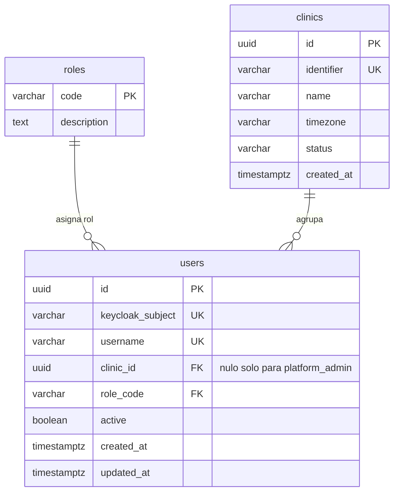
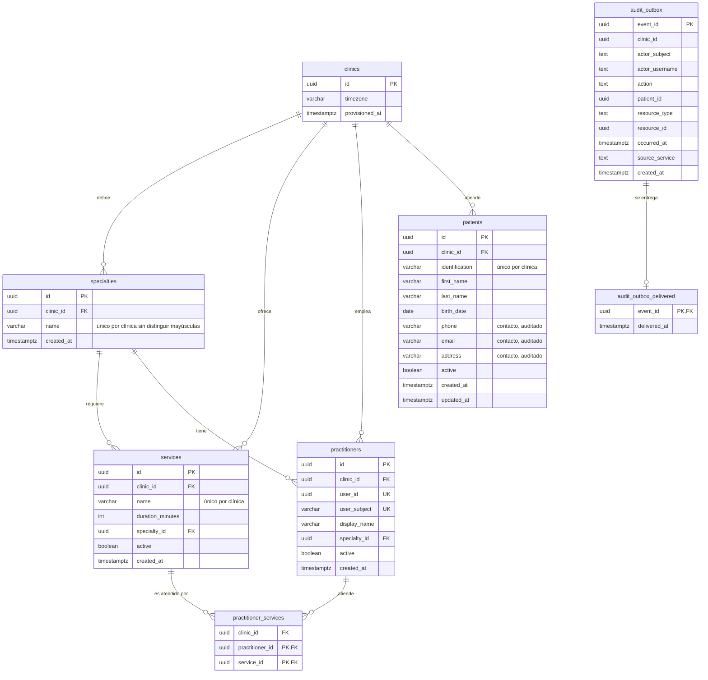
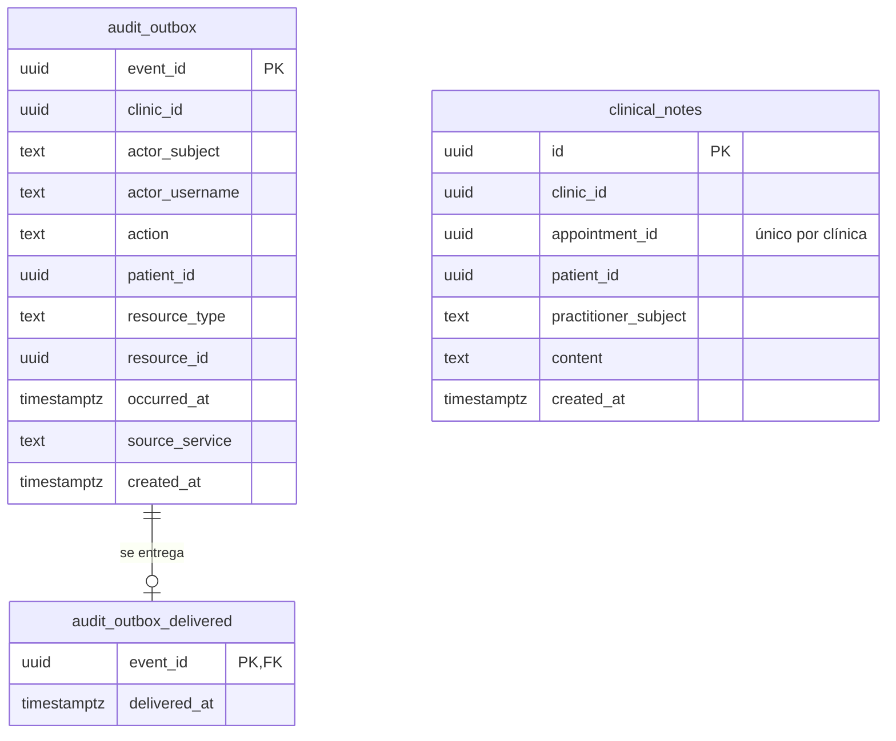
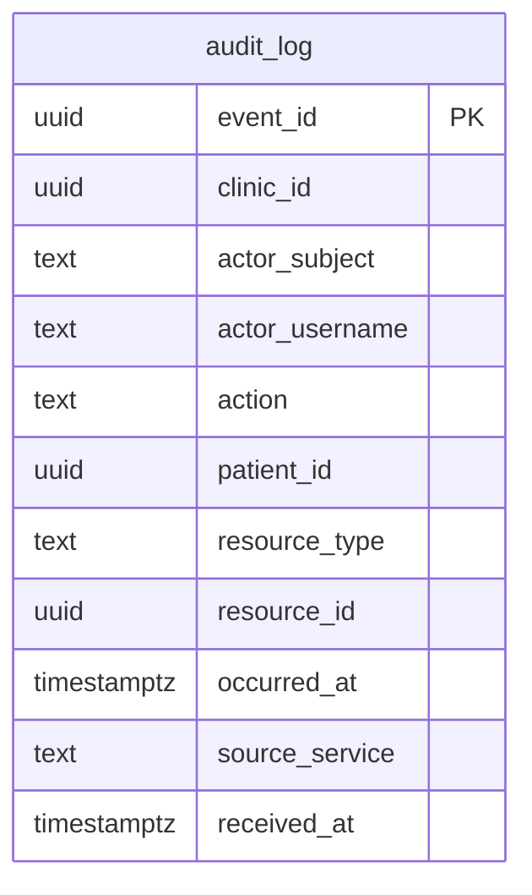
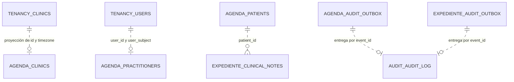
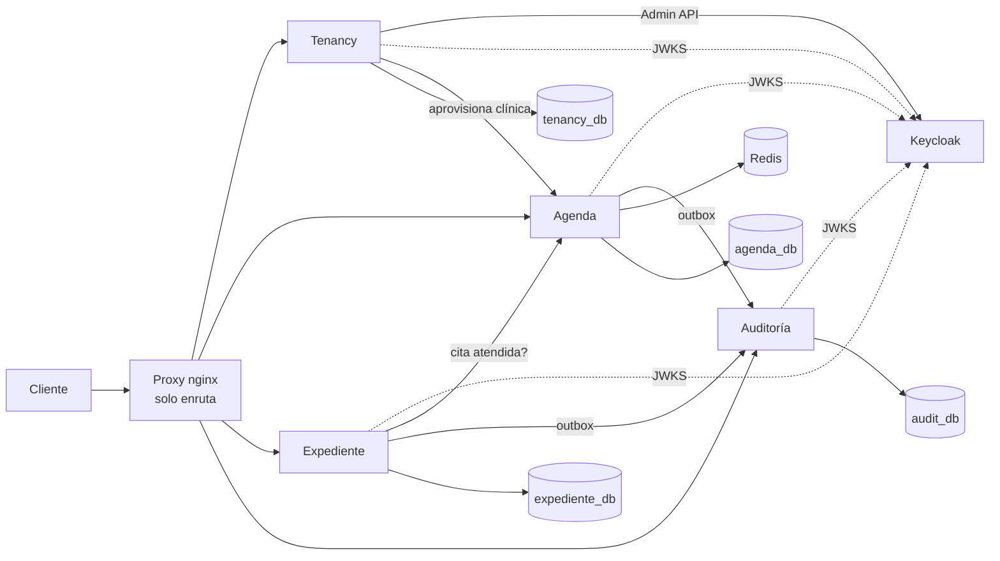

# Documento de diseño

Este documento reúne el diseño de MediCitas: el modelo de datos, la estrategia de multi-tenancy, la arquitectura de servicios y la seguridad de la base de datos. Cada decisión viene con las alternativas que se consideraron y lo que se sacrificó.

**Estado:** las tablas de horarios, bloqueos y citas de Agenda todavía no existen en el repositorio. Cada sección que depende de ellas está marcada como pendiente.

| Sección | Estado |
|---|---|
| 1. Modelo de datos: diagramas ER, 3FN y desnormalizaciones | Completo para las tablas existentes |
| 1.5 Diccionario de datos | Pendiente |
| 2. Multi-tenancy: comparación y decisión | Completo; las mediciones de RLS están pendientes |
| 3. Arquitectura de servicios | Completo; las decisiones de concurrencia y de caché dependen de Agenda |
| 4. Seguridad de la base de datos y auditoría | Completo |

---

## 1. Modelo de datos

### 1.1 Visión general

El sistema usa una instancia de PostgreSQL con **una base de datos por servicio**. Postgres no permite `JOIN` entre bases, así que la frontera entre servicios la impone el motor. Las referencias entre bases son **lógicas** (un identificador sin llave foránea) y se validan en la aplicación.

| Base | Servicio | Tablas | Migraciones |
|---|---|---|---|
| `tenancy_db` | Tenancy | `roles`, `clinics`, `users` | `migrations/tenancy` |
| `agenda_db` | Agenda | `clinics`, `specialties`, `services`, `practitioners`, `practitioner_services`, `patients`, `audit_outbox`, `audit_outbox_delivered` | `migrations/agenda` |
| `expediente_db` | Expediente | `clinical_notes`, `audit_outbox`, `audit_outbox_delivered` | `migrations/expediente` |
| `audit_db` | Auditoría | `audit_log` | `migrations/audit` |

Convenciones comunes a todo el modelo:

- Los identificadores son `UUID` generados por la base (`gen_random_uuid()`).
- Las fechas con hora son `TIMESTAMPTZ`.
- Toda tabla de datos de una clínica lleva la columna `clinic_id`.
- En Agenda, toda relación entre tablas de una clínica es una **llave foránea compuesta** `(clinic_id, id)`. Así el motor rechaza una fila que apunte a otra clínica (I5).

### 1.2 Diagramas entidad-relación

Se muestra un diagrama por base y uno con las referencias lógicas entre bases. Las líneas punteadas son referencias sin llave foránea.

#### Tenancy



#### Agenda



Las llaves foráneas hacia `specialties`, `services`, `practitioners` y entre `practitioner_services` y sus padres son **compuestas** `(clinic_id, id)`. El diagrama las dibuja como una sola línea para mantenerlo legible.

#### Expediente



#### Auditoría



#### Referencias lógicas entre bases



Ninguna de estas relaciones tiene llave foránea, porque cada extremo vive en una base distinta. La coherencia se mantiene así:

- **Clínicas:** Tenancy crea la clínica y la proyecta a Agenda con una saga, con compensación si falla.
- **Profesionales:** Agenda consulta a Tenancy, con el token del usuario, antes de registrar un profesional.
- **Notas clínicas:** Expediente verifica la cita con Agenda antes de aceptar una nota. Esa verificación espera a que existan las citas.
- **Auditoría:** el relay entrega los eventos de forma idempotente por `event_id`.

### 1.3 Normalización hasta la tercera forma normal

#### Criterio

| Forma | Qué exige | Cómo se comprobó |
|---|---|---|
| **1FN** | Valores atómicos, sin grupos repetidos | Ninguna columna guarda listas. Las relaciones muchos a muchos tienen su propia tabla (`practitioner_services`) |
| **2FN** | Ningún atributo depende de solo una parte de la clave | Se revisó cada tabla con clave compuesta. Hay una excepción deliberada (ver 1.4) |
| **3FN** | Ningún atributo no clave depende de otro atributo no clave | Se escribieron las dependencias funcionales de cada tabla y se buscó si un atributo no clave determina a otro |

#### Caso trabajado: las especialidades

Es el paso de normalización que se hizo sobre el esquema original (migración `0003_specialties`).

**Antes.** `services` y `practitioners` guardaban `specialty` como texto libre:

```
services(id, clinic_id, name, duration_minutes, specialty, ...)
practitioners(id, clinic_id, display_name, specialty, ...)
```

El nombre de una especialidad es un hecho sobre la especialidad, no sobre el servicio ni sobre el profesional. Guardarlo en cada fila provoca anomalías:

| Anomalía | Ejemplo |
|---|---|
| **Actualización** | Corregir "Pediatria" a "Pediatría" obliga a modificar todas las filas de `services` y `practitioners` que lo repiten. Si se olvida una, queda inconsistente |
| **Inserción** | No existe una especialidad sin un servicio o profesional que la use |
| **Borrado** | Eliminar el único servicio de una especialidad hace desaparecer la especialidad |
| **Inconsistencia** | "Medicina general" y "medicina general" se tratan como dos especialidades distintas |

Esto es una **dependencia transitiva**: `servicio → especialidad → nombre de la especialidad`. Viola la 3FN.

**Después.** El nombre vive una sola vez en su propia tabla y las demás referencian su identificador:

```
specialties(id, clinic_id, name)              -- único por (clinic_id, lower(name))
services(id, clinic_id, ..., specialty_id)    -- FK compuesta (clinic_id, specialty_id)
practitioners(id, clinic_id, ..., specialty_id)
```

Qué se ganó:

- El nombre depende de la clave de `specialties`, y nada más.
- La unicidad sin distinguir mayúsculas elimina la inconsistencia.
- La comparación "el servicio requiere la especialidad del profesional" (RF4) se hace por identificador y no por texto.
- La llave foránea compuesta impide asignar la especialidad de otra clínica (I5).

Qué se sacrificó: las consultas de lectura necesitan un `JOIN` con `specialties` para mostrar el nombre. Es un costo pequeño, porque la unión es por clave y está cubierta por índice.

#### Análisis por tabla

La columna "Determinantes" lista las claves candidatas. Todas las demás columnas dependen únicamente de ellas.

**Tenancy**

| Tabla | Determinantes | Veredicto |
|---|---|---|
| `roles` | `code` | 3FN. La descripción depende solo del código. Separar la tabla evita repetir la descripción en cada usuario |
| `clinics` | `id`, `identifier` | 3FN |
| `users` | `id`, `keycloak_subject`, `username` | 3FN. `role_code` referencia a `roles`, en lugar de guardar la descripción del rol |

**Agenda**

| Tabla | Determinantes | Veredicto |
|---|---|---|
| `clinics` | `id` | 3FN. Es una proyección de la clínica de Tenancy (ver 1.4) |
| `specialties` | `id`, `(clinic_id, lower(name))` | 3FN |
| `services` | `id`, `(clinic_id, name)` | 3FN. La especialidad se referencia por `specialty_id` |
| `practitioners` | `id`, `user_id`, `user_subject` | 3FN. `user_id` y `user_subject` son claves candidatas entre sí, no una dependencia transitiva |
| `practitioner_services` | `(practitioner_id, service_id)` | 1FN y 3FN, con una **excepción de 2FN deliberada**: `clinic_id` depende solo de una parte de la clave (ver 1.4) |
| `patients` | `id`, `(clinic_id, identification)` | 3FN. El contacto (teléfono, correo, dirección) depende del paciente, no de otro atributo |
| `audit_outbox` | `event_id` | Excepción deliberada: `resource_type` y `source_service` se derivan de `action` (ver 1.4) |
| `audit_outbox_delivered` | `event_id` | 3FN |

**Expediente**

| Tabla | Determinantes | Veredicto |
|---|---|---|
| `clinical_notes` | `id`, `(clinic_id, appointment_id)` | Excepción deliberada: `patient_id` y `practitioner_subject` se derivan de la cita (ver 1.4) |
| `audit_outbox`, `audit_outbox_delivered` | Igual que en Agenda | Igual que en Agenda |

**Auditoría**

| Tabla | Determinantes | Veredicto |
|---|---|---|
| `audit_log` | `event_id` | Excepción deliberada: `resource_type` y `source_service` se derivan de `action` (ver 1.4) |

### 1.4 Desnormalizaciones deliberadas

El enunciado exige documentar cada desnormalización con su motivo. Estas son todas las que existen:

| # | Dónde | Qué se repite o se deriva | Motivo | Cómo se mantiene consistente |
|---|---|---|---|---|
| 1 | `practitioner_services.clinic_id` | Depende de `practitioner_id` (y de `service_id`), o sea de parte de la clave. Viola 2FN | Permite que las dos llaves foráneas sean **compuestas** `(clinic_id, id)`, y así el motor impide asociar un profesional con un servicio de otra clínica (I5) | Las dos llaves foráneas compuestas obligan a que el `clinic_id` coincida con el del profesional y con el del servicio |
| 2 | `agenda.clinics.timezone` | Copia del `timezone` de `tenancy.clinics` | Agenda necesita la zona horaria de cada clínica para calcular horarios, disponibilidad y agenda del día sin llamar a Tenancy en cada consulta | Tenancy es la fuente de verdad y la proyecta a Agenda al crear la clínica (saga con compensación). Esa ruta interna es idempotente |
| 3 | `tenancy.users.role_code` | Copia del rol de realm de Keycloak | Tenancy muestra y filtra usuarios por rol sin consultar a Keycloak | Keycloak es la fuente de verdad. Tenancy lo actualiza después de Keycloak en cada cambio de rol |
| 4 | `clinical_notes.patient_id` y `practitioner_subject` | Se derivan de la cita (`appointment_id`), que vive en Agenda | Expediente debe autorizar ("solo el profesional de la cita") y auditar sin llamar a Agenda en cada lectura. Los datos se toman del contexto verificado de la cita en el momento de escribir la nota | Se escriben una sola vez, junto con la nota, y la nota no se modifica (el rol de la aplicación solo tiene `SELECT` e `INSERT`) |
| 5 | `audit_log` y `audit_outbox`: `resource_type` y `source_service` | Se derivan de `action` | La bitácora es un registro **inmutable** de hechos. Guardar el valor evita una tabla de acciones y un `JOIN` en cada consulta de auditoría | La migración fija con `CHECK` qué combinaciones son válidas, y el contrato del evento lo asigna el escritor del outbox |
| 6 | `audit_log.actor_username` y `audit_outbox.actor_username` | Copia del nombre de usuario en el momento del evento | La bitácora conserva quién actuó aunque el usuario cambie o se dé de baja. La identidad estable es `actor_subject` | Es una instantánea de solo escritura, que el trigger de inmutabilidad impide modificar |
| 7 | `audit_outbox.patient_id`, `clinic_id` (sin llave foránea) | Referencia lógica a `patients` | El outbox es append-only y no debe depender de que el paciente exista ni bloquear su escritura. En Expediente el mismo campo referencia a una base distinta | La aplicación escribe el evento dentro de la misma transacción que la operación sobre el paciente |

> **Nota.** Los motivos de las filas 3 a 7 se leyeron de las migraciones y de los comentarios del código de Tenancy, Expediente y Auditoría, que no son de quien escribe este documento. Conviene confirmarlos con quien los diseñó antes de defenderlos.

### 1.5 Pendiente

- **Horarios, bloqueos y citas de Agenda.** Se documentarán a partir de sus migraciones cuando existan. La arquitectura prevé una restricción de exclusión sobre `appointments` para I1 e I2 (ver la sección 3.4).
- **Diccionario de datos** de las cuatro bases, que irá en esta sección.

---

## 2. Multi-tenancy

### 2.1 Qué debe lograr

El invariante **I5** dice: ningún dato de una clínica resulta accesible desde otra, por ninguna ruta ni combinación de parámetros. Es el corazón del producto, porque una fuga entre clínicas expone datos clínicos de personas.

Hay tres cosas que la estrategia debe resistir:

1. **Un error del programador:** una consulta que olvida filtrar por clínica.
2. **Un cliente malicioso:** quien manipula un identificador o un parámetro para alcanzar otra clínica.
3. **Un servicio comprometido:** un servicio que intenta leer datos que no son suyos.

### 2.2 Estrategias consideradas

| Estrategia | Cómo funciona |
|---|---|
| **A. Esquema (o base) por tenant** | Cada clínica tiene su propio esquema con sus propias tablas. Las consultas se dirigen al esquema de la clínica |
| **B. Columna discriminadora** | Todas las clínicas comparten las tablas, y cada fila lleva `clinic_id`. Cada consulta filtra por esa columna. Las llaves foráneas compuestas `(clinic_id, id)` impiden relacionar filas de clínicas distintas |
| **C. Row-Level Security (RLS)** | Todas las clínicas comparten las tablas, y el motor aplica una política que oculta las filas que no son de la clínica de la sesión, sin importar lo que diga la consulta |

#### Comparación

| Criterio | A. Esquema por tenant | B. Columna discriminadora | C. RLS |
|---|---|---|---|
| **Aislamiento ante un error de consulta** | Alto: una consulta sin filtro solo ve su esquema | **Bajo por sí solo:** una consulta sin `WHERE clinic_id` ve todo | Alto: el motor filtra aunque la consulta no lo haga |
| **Aislamiento relacional** (una fila no apunta a otra clínica) | Natural, porque no comparten tablas | Se logra con llaves foráneas compuestas | No lo da por sí solo, porque las políticas filtran lecturas y escrituras, pero no relaciones |
| **Costo operativo con muchas clínicas** | Alto: cada clínica nueva crea tablas, y cada migración se aplica N veces | **Bajo:** una migración sirve a todas | Bajo: una migración sirve a todas |
| **Alta de una clínica** | Crea un esquema y todas sus tablas | **Una fila** | Una fila |
| **Migraciones de esquema** | Hay que recorrer todos los esquemas y se puede dejar a unos desactualizados | **Una sola vez** | Una sola vez |
| **Consultas entre clínicas** (administración de plataforma, métricas) | Difíciles: hay que unir esquemas | **Simples** | Simples, con un rol que omite la política |
| **Conexiones y caché de planes** | Cada esquema tiene sus propios objetos, lo que reduce el aprovechamiento de planes y conexiones | **Aprovecha un solo conjunto de tablas** | Igual que B |
| **Riesgo de fuga por descuido del programador** | Bajo | **El más alto: depende de no olvidar el filtro en cada consulta** | Bajo |
| **Respaldo o restauración de una sola clínica** | **Fácil** | Difícil: hay que extraer sus filas | Difícil |
| **Rendimiento** | Bueno | Bueno, con índices que empiezan por `clinic_id` | Depende: el motor evalúa la política en cada fila. **Se medirá** (sección 2.7) |

### 2.3 Decisión

**Mecanismo principal: B, columna discriminadora, reforzada con llaves foráneas compuestas y con el `clinic_id` tomado del token firmado.** **Como segunda estrategia, comparada y activable: C, RLS**, que se implementa en paralelo y se mide sobre las mismas consultas (módulo del grupo de tres).

Esta decisión es la misma que sostiene I5 en la sección 3.4. Aquí se justifica.

**Por qué B y no A**

- **El producto es SaaS con muchas clínicas.** Con esquema por tenant, cada clínica nueva obliga a crear y migrar un esquema completo. El alta de una clínica es una fila (RF1) y es parte de una saga que debe ser simple y con compensación.
- **Las migraciones se aplican una sola vez.** Con A habría que aplicarlas a cada esquema, y un fallo a mitad deja clínicas con versiones distintas.
- **La administración de plataforma necesita ver todas las clínicas** (listarlas y aprovisionarlas), algo que con A obliga a unir esquemas.
- **Las llaves foráneas compuestas dan el aislamiento relacional** que A daría de forma natural, y lo hacen dentro de un mismo conjunto de tablas.

**Por qué no basta B por sí solo**

El punto débil de B es que el aislamiento depende de que **cada consulta** incluya el filtro. Un solo `SELECT` sin `WHERE clinic_id` es una fuga. Por eso B se combina con otras capas (sección 2.4), y por eso existe RLS como segunda estrategia: lo que B deja en manos del programador, RLS lo deja en manos del motor.

**Por qué RLS como segunda estrategia y no como principal**

- Su rendimiento depende de las políticas y de los índices, y todavía no se ha medido.
- No resuelve el aislamiento relacional entre tablas, que sí resuelven las llaves foráneas compuestas.
- Conviene tenerlo implementado y medido antes de decidir si pasa a ser obligatorio. La comparación con mediciones es parte del módulo extra.

### 2.4 Cómo se implementa

La protección tiene varias capas independientes. Si una falla, las otras siguen:

| Capa | Mecanismo | Dónde |
|---|---|---|
| **1. Identidad** | El `clinic_id` viaja **firmado** en el token de Keycloak. Los servicios validan la firma, el emisor, la expiración y el destinatario | `internal/platform/auth` |
| **2. La clínica no viene de la petición** | La clínica sale del actor autenticado. Las entradas de las rutas no tienen un campo de clínica, y un `clinic_id` falsificado en el cuerpo o en la consulta se ignora | Servicios y *handlers* |
| **3. Filtro en cada consulta** | Toda consulta recibe la clínica del actor y filtra por `clinic_id` junto con el identificador del recurso | Almacenes (`store`) |
| **4. Transacción con clínica** | Toda operación corre dentro de `TxManager` con `ClinicID`, que fija `app.clinic_id` solo durante la transacción (`set_config` local). Así una conexión del pool nunca arrastra una clínica a otra petición, y las políticas de RLS pueden leerla | `internal/platform/database/tx.go` |
| **5. Restricciones del motor** | Llaves foráneas compuestas `(clinic_id, id)` en Agenda. El motor rechaza una fila que apunte a otra clínica | Migraciones |
| **6. Respuesta sin filtraciones** | Un recurso de otra clínica responde **404**, igual que uno inexistente, para no revelar que existe. Una violación de llave foránea se traduce también a 404 | `database.MapError` |
| **7. Una base por servicio** | Cada servicio solo puede conectarse a su propia base. Un servicio comprometido no alcanza las demás | Roles de PostgreSQL |
| **8. Roles sin atajos** | Los roles de la aplicación son `NOSUPERUSER` y `NOBYPASSRLS`. No pueden omitir las políticas de RLS | Sección 4 |

### 2.5 Compromisos aceptados

| Compromiso | Qué se sacrifica | Por qué se acepta |
|---|---|---|
| **El filtro depende del programador** | Con B, una consulta sin filtro es una fuga | Se mitiga con las capas 3 a 6, con pruebas automáticas, y con RLS como segunda capa |
| **Respaldo por clínica** | No se puede restaurar fácilmente a una sola clínica | No es un requisito de esta etapa. Se extraerían sus filas por `clinic_id` |
| **`clinic_id` repetido en cada tabla hija** | Una columna más y llaves compuestas más anchas | Es el precio del aislamiento relacional (ver desnormalización 1 en 1.4) |
| **Un vecino ruidoso** | Una clínica muy activa comparte tablas e índices con las demás | Con el tamaño de esta etapa no es un riesgo real. Los índices empiezan por `clinic_id` |
| **Tokens de vida corta, no inmediatos** | Un cambio de clínica o de rol surte efecto al vencer el token (5 minutos) | Compromiso documentado en la sección 3.5 |

### 2.6 Cómo se demuestra I5

El enunciado pide demostrar I5 con pruebas automáticas que incluyan **intentos deliberados de fuga**. Hoy existen estas:

| Prueba | Qué intenta | Dónde |
|---|---|---|
| Aislamiento de pacientes | Leer o modificar un paciente de otra clínica, listarlo con `clinic_id` manipulado en el cuerpo y en la consulta, y buscar su identificación desde otra clínica | `cmd/agendacheck` (contra la pila real) |
| Aislamiento de la bitácora | Consultar desde otra clínica los eventos de auditoría de un paciente ajeno | `cmd/agendacheck` |
| La clínica sale del actor | Verificar que todas las operaciones de pacientes usan la clínica del actor, y que ninguna entrada tiene un campo de clínica | `internal/agenda/patients_test.go` (unitarias) |
| Aislamiento de servicios y usuarios | Leer servicios y usuarios de otra clínica, con la clínica falsificada en un encabezado | `cmd/p1check` |
| Fronteras entre bases | Conectarse con las credenciales de un servicio a la base de otro | `db-security-test` |

Las pruebas de fuga de los cuatro servicios están pendientes de ampliarse.

### 2.7 Pendiente: RLS y mediciones

El módulo extra implementará RLS en `agenda_db` y comparará ambas estrategias **sobre las mismas consultas**, con pruebas de aislamiento y mediciones. Esta sección se completará con:

- las políticas de RLS por tabla;
- las pruebas que demuestren que RLS bloquea una consulta sin filtro;
- las mediciones de B contra C, con la consulta, el plan de ejecución y el tiempo;
- la conclusión sobre si RLS debe pasar a ser obligatoria.

Hasta entonces, la decisión de la sección 2.3 se mantiene, y **no se afirma ningún resultado de rendimiento** que no se haya medido.

---

## 3. Arquitectura de servicios

### 3.1 Contexto y pregunta rectora

MediCitas es una plataforma SaaS multi-tenant: una empresa la vende a muchas clínicas y los datos de cada una permanecen aislados. El sistema se separa en servicios, y el diseño gira alrededor de la pregunta del enunciado:

> Dos recepcionistas reservan el último espacio de la agenda exactamente al mismo tiempo. ¿Qué hace el sistema, por qué, y cómo se demuestra?

Cualquier separación en servicios debe dejar esa pregunta igual de fácil de responder y de demostrar que en un monolito.

### 3.2 Criterios y opciones evaluadas

Criterios, en orden de prioridad:

1. **Invariantes con transacciones locales.** I1–I4, I7 e I8 deben garantizarse dentro de una sola transacción de una sola base de datos. No es negociable.
2. **La reserva no depende de la red.** RF9 es la operación crítica y no debe fallar porque otro servicio esté caído.
3. **Aislamiento del dato más sensible.** La nota clínica (RF15) debe quedar detrás de credenciales que ningún otro servicio tenga.
4. **Bitácora atómica, protegida en el motor y consultable en un solo lugar** (RF18, RF19, I6).
5. **Costo y riesgo.** `docker compose up` debe funcionar siempre, sin intervención.

**Regla de corte:** se separa donde no se rompe ninguna transacción que sostiene un invariante, y donde se gana aislamiento de datos sensibles.

| Opción | Invariantes locales | Reserva sin red | Notas aisladas | Bitácora | Costo |
|---|---|---|---|---|---|
| A. Monolito modular | ✓ | ✓ | ~ (mismo proceso) | ✓ | Bajo |
| B. 3 servicios: Tenancy, Agenda y Clínico (pacientes junto a las notas) | ✓ | ✗ | ✓ | ✓ | Medio |
| C. 4 servicios con gateway propio y pacientes junto a las notas | ✓ | ✗ | ✓ | ~ | Medio-alto |
| **D. 4 servicios: Tenancy, Agenda, Expediente y Auditoría (pacientes en Agenda)** | ✓ | ✓ | ✓ | ✓ | Medio-alto |
| E. Grano fino (catálogo, disponibilidad, etc. por separado) | ✗ | ✗ | ✓ | ~ | Muy alto |

**Por qué se descartan las demás:**

- **E** separa piezas que deben decidirse en la misma transacción. Separar el catálogo rompe I4 (la duración de un servicio podría cambiar durante una reserva). Separar la disponibilidad rompe I7 e I8 (la invalidación dejaría de ocurrir junto al commit de la reserva). Es el antipatrón conocido como "monolito distribuido".
- **B y C** ponen a los pacientes junto a las notas. Eso obliga a la reserva a preguntarle a otro servicio si el paciente existe y es de la misma clínica, lo que vuelve dependiente de la red a la operación crítica y deja la protección de I5 en esa operación en manos de una llamada HTTP en lugar de una restricción de la base de datos. Además, la agenda del día (RF20) tendría que pedir los nombres de los pacientes a otro servicio.
- **C**, además, propaga la clínica y el rol en encabezados desde un gateway propio. Si alguien llega directo a un servicio, puede inventarlos y romper I5.
- **A** es técnicamente impecable, pero deja todo el trabajo de separación para la etapa siguiente.

**Decisión: opción D.**

### 3.3 Servicios



Las cuatro bases viven en **una sola instancia de PostgreSQL**, cada una con sus propios roles. Keycloak, Redis y PostgreSQL son infraestructura, no servicios de dominio.

| Servicio | Qué hace | Requisitos | Por qué está aparte |
|---|---|---|---|
| **Tenancy** | Da de alta clínicas y usuarios, asigna roles y da de baja. Es el único con alcance sobre todas las clínicas y el único con las credenciales de administración de Keycloak | RF1, RF2 | Concentra el poder sobre todas las clínicas en un solo lugar |
| **Agenda** | Catálogo, profesionales, horarios, bloqueos, pacientes, disponibilidad, citas y su ciclo de vida | RF3–RF14, RF16, RF20, RF21 | Es el servicio grande a propósito: la reserva lee horario, bloqueos, duración, profesionales y citas, y escribe, todo en **una sola transacción**. Tener los pacientes aquí permite garantizar I2 e I5 con restricciones del motor, sin llamadas de red |
| **Expediente** | Guarda las notas clínicas. Solo el profesional que atendió la cita escribe su nota | RF15 | Si alguien compromete Agenda, que tiene más rutas y más superficie de ataque, no tiene credenciales para leer las notas |
| **Auditoría** | Recibe los registros de acceso de Agenda y Expediente, los guarda de forma append-only y los expone al administrador de la clínica | RF19 (y almacén central de RF18) | Tiene dos productores, y quien es vigilado no guarda las grabaciones: si alguien compromete Expediente, no puede borrar el registro de lo que hizo, porque está en otra base con otras credenciales |

Alta de una clínica (RF1): toca tres sistemas (la base de Tenancy, Keycloak y Agenda) sin transacción común. Se resuelve con una **saga pequeña**: la clínica se registra en estado `provisioning`, cada paso es idempotente y se reintenta, y al terminar pasa a `active`. Es una operación poco frecuente y de administración, así que la consistencia eventual es aceptable.

### 3.4 Cómo se garantiza cada invariante

| Invariante | Mecanismo | Dónde |
|---|---|---|
| **I1** Profesional sin citas solapadas | Restricción de exclusión `EXCLUDE USING gist (practitioner_id WITH =, tstzrange(starts_at, ends_at) WITH &&) WHERE (status = 'reservada')` (requiere `btree_gist`). Una reserva concurrente recibe `23P01` y se responde 409 "espacio ya tomado" | Agenda (motor) |
| **I2** Paciente sin citas solapadas | Restricción de exclusión equivalente sobre `patient_id` | Agenda (motor) |
| **I3** Dentro del horario y fuera de bloqueos | Validación dentro de la transacción de reserva, con bloqueo de la fila del profesional (`SELECT … FOR UPDATE`), que también toman la creación de bloqueos y los cambios de horario. Así un bloqueo no se cuela entre la validación y la inserción | Agenda |
| **I4** Duración fijada por el servicio | `ends_at` se calcula a partir de la duración del servicio dentro del mismo `INSERT`, y un trigger impide modificarlo después | Agenda (motor) |
| **I5** Aislamiento entre clínicas | `clinic_id` tomado del token firmado, nunca de la petición. Llaves foráneas compuestas `(clinic_id, id)` en todas las relaciones. Una base por servicio. RLS como segunda capa (ver la sección 2) | Todos |
| **I6** Bitácora inmodificable | Rol de la aplicación con solo `INSERT` y `SELECT`, y un trigger que rechaza `UPDATE` y `DELETE`, tanto en `audit_log` como en cada `audit_outbox` (ver la sección 4.3) | Auditoría, Agenda, Expediente |
| **I7** Cancelar o reprogramar libera de inmediato | El cambio de estado excluye la cita de la restricción de exclusión en la misma transacción, y la caché se invalida tras el commit | Agenda |
| **I8** La caché no contradice la base | Invalidación después del commit, con un número de versión por agenda (ver la sección 3.7) | Agenda y Redis |

I1, I2, I3, I4 e I7 son diseño previsto: las tablas de horarios, bloqueos y citas todavía no existen en el repositorio.

**Nivel de aislamiento de las transacciones.** Se propone **READ COMMITTED**, el que usa PostgreSQL por defecto, porque I1 e I2 los garantiza la restricción de exclusión y no la lectura previa. La decisión final, su comparación con SERIALIZABLE y el manejo de deadlocks (orden de bloqueo consistente y reintento ante `40P01` y `40001`) quedan para el documento de concurrencia de Agenda.

### 3.5 Identidad y autorización

- **Keycloak** emite tokens OIDC con el rol (rol de realm) y la clínica (atributo `clinic_id`, mediante un *protocol mapper*). En Keycloak 26 el atributo debe declararse en el *user profile* del realm, porque los atributos no declarados están desactivados por defecto.
- **Cada servicio valida el token por su cuenta**: firma contra las llaves públicas, emisor, expiración y destinatario. Nunca se confía en encabezados como `X-Clinic-Id`.
- **Tokens de vida corta (5 minutos).** Una baja o un cambio de rol surte efecto, como máximo, al vencer el token. Los inicios de sesión nuevos se bloquean al instante. Es un compromiso aceptado.
- **Dos niveles de autorización:**
  1. Por ruta: el rol del token debe tener el permiso (401 sin token válido, 403 sin el rol).
  2. Por recurso, dentro del servicio: reglas como "solo los propios" o "solo de citas propias" se revisan con un `Actor` (usuario, clínica y rol) que recibe la capa de servicio.
- **Llamadas entre servicios.** Si la llamada nace de un usuario (Expediente hacia Agenda), se reenvía su token, para que el servicio llamado aplique el aislamiento con la identidad real. Si no hay usuario (relay de auditoría, aprovisionamiento), se usa un token de *client credentials*, con un client confidencial por servicio.

### 3.6 Consistencia entre servicios

| Interacción | Tipo | Consistencia | Por qué es aceptable |
|---|---|---|---|
| Reservar, reprogramar, cancelar | Local | Fuerte (ACID) | Restricciones de exclusión en una sola base |
| Disponibilidad desde caché | Local y Redis | Fuerte para la siguiente lectura | Invalidación tras el commit, versionada |
| Nota hacia cita atendida | Síncrona (Expediente hacia Agenda) | Fuerte | "Atendida" es un estado final (RF13): una vez verificada no puede cambiar, así que no hay carrera |
| Registro de auditoría en origen | Local, en la misma transacción | Fuerte (atómica) | Se escribe en `audit_outbox` junto con la acción auditada |
| Bitácora central (RF19) | Asíncrona (outbox hacia Auditoría) | Eventual (segundos) | Entrega garantizada y sin duplicados |
| Clínica y rol en el token | Keycloak | Hasta la vida del token | Token de 5 minutos, y Keycloak bloquea los inicios de sesión nuevos al instante |
| Alta de clínica (RF1) | Saga en Tenancy | Eventual | Operación poco frecuente, con pasos idempotentes |

Dependencias entre servicios, y qué pasa si el destino no responde:

| Origen hacia destino | Para qué | Si el destino no responde |
|---|---|---|
| Expediente hacia Agenda | Verificar que la cita está atendida y por quién (RF15) | No se puede escribir la nota (503). El resto del sistema funciona |
| Tenancy hacia Agenda | Aprovisionar la clínica (RF1) | La clínica queda en `provisioning` y se reintenta |
| Tenancy hacia Keycloak | Crear usuarios, roles y atributo de clínica | El alta queda pendiente y se reintenta |
| Agenda hacia Tenancy | Validar que el usuario de un profesional existe y tiene ese rol (RF4) | No se puede registrar el profesional. Las reservas no se afectan |
| Agenda y Expediente hacia Auditoría | Entregar los eventos de RF18 | Los eventos esperan en el outbox y nada se pierde |
| Todos hacia Keycloak | Llaves públicas | Se usan las llaves en caché hasta que vencen |

**La reserva (RF9) no depende de ningún otro servicio.**

### 3.7 Caché de disponibilidad (propuesta)

Pendiente de decisión y medición por quien implemente la caché. La propuesta de diseño es:

- **Clave** por profesional, fecha y servicio, que incluye un **número de versión de esa agenda**: `avail:{clinica}:{profesional}:{fecha}:{servicio}:v{n}`.
- **Invalidación:** tras el commit de cualquier cambio que afecte esa agenda (reserva, cancelación, reprogramación, bloqueo o cambio de horario) se incrementa la versión.
- **Lectura:** un lector obtiene la versión **antes** de leer la base y guarda el resultado bajo esa versión. Si una reserva hace commit mientras tanto, la versión sube y el resultado viejo queda huérfano: nadie lo vuelve a leer. Así se evita la carrera clásica en que una lectura vieja se escribe en la caché después de haberla invalidado.
- **Redis no es fuente de verdad:** la fuente sigue siendo la base relacional.
- **Por decidir:** qué hacer si Redis no responde durante la invalidación (por ejemplo, no servir desde la caché mientras no esté sano).

---

## 4. Seguridad de la base de datos y auditoría

### 4.1 Perfiles de PostgreSQL

Cada servicio tiene su propia base y tres perfiles de menor privilegio:

| Perfil | Para qué | DDL | SELECT | INSERT | UPDATE | DELETE |
|---|---|:-:|:-:|:-:|:-:|:-:|
| `<servicio>_owner` | Migraciones | sí | sí | sí | sí | sí |
| `<servicio>_app` | Identidad de la aplicación | no | sí | sí | sí | sí |
| `<servicio>_readonly` | Diagnóstico de solo lectura | no | sí | no | no | no |
| `audit_app` | Aplicación de Auditoría | no | sí | sí | no | no |

- Los trabajos de migración se conectan como `<servicio>_owner`. Las contraseñas de los dueños no se entregan a los contenedores de la aplicación.
- Los servicios en Go se conectan como `<servicio>_app`.
- `expediente_app` solo tiene `SELECT` e `INSERT` sobre `clinical_notes`, porque RF15 no define actualizar ni borrar notas.

### 4.2 Aislamiento entre bases y atributos de los roles

- Cada servicio recibe `CONNECT` únicamente sobre su propia base. `PUBLIC` no recibe privilegios sobre ninguna base de servicio ni sobre el esquema `public`.
- Solo `<servicio>_owner` puede crear objetos. Los perfiles de aplicación y de lectura solo reciben `USAGE`.
- Todos los roles son `NOSUPERUSER`, `NOCREATEDB`, `NOCREATEROLE`, `NOREPLICATION` y `NOBYPASSRLS`. Por eso la aplicación no puede omitir las políticas de RLS.
- Un servicio comprometido no puede usar sus credenciales normales para conectarse a la base de otro.

**Roles de dominio.** Mapear los roles `clinic_admin`, `reception` y `practitioner` a roles de PostgreSQL con `SET LOCAL ROLE` dentro de cada transacción es una decisión pendiente. Permitiría aplicar también la matriz de permisos en el motor, y el mismo mecanismo sirve para RLS.

### 4.3 Auditoría append-only (RF18, RF19, I6)

**Qué se audita.** Toda lectura y escritura de los datos de contacto de pacientes (Agenda) y de las notas clínicas (Expediente). Un evento registra la clínica, el subject y el usuario autenticados, la acción, el paciente, el recurso afectado, la hora y el servicio productor. Los valores de contacto y el contenido de las notas **nunca** se copian al evento.

**Outbox transaccional.** Agenda y Expediente escriben el evento en su `audit_outbox` **dentro de la misma transacción** que la operación sensible. Si la transacción se revierte, no quedan ni la operación ni su evento. Así RF18 e I6 se cumplen en el origen aunque Auditoría esté caída.

**Entrega.** Un *relay* dentro de cada servicio obtiene un token de cuenta de servicio (*client credentials*) y envía los eventos pendientes a una ruta interna de Auditoría. La entrega es **al menos una vez**, y Auditoría guarda cada evento con `ON CONFLICT (event_id) DO NOTHING`, así que el resultado es **exactamente una vez**. El relay no modifica el outbox: registra lo entregado en `audit_outbox_delivered` y en cada ciclo toma los eventos que todavía no aparecen ahí. No usa un cursor con el último identificador enviado, porque los identificadores de una secuencia pueden hacer commit fuera de orden y un cursor se saltaría eventos.

**Consulta (RF19).** El administrador de la clínica consulta `GET /api/v1/audit` con filtros por usuario, paciente y rango de fechas. La clínica sale siempre del token. Recepción, profesionales y administración de plataforma no pueden consultarla.

**Inmutabilidad (I6).** Se protege con dos controles independientes:

1. `audit_app` no tiene `UPDATE`, `DELETE` ni `TRUNCATE` sobre `audit_log`.
2. Un trigger de PostgreSQL rechaza `UPDATE` y `DELETE`, incluso con la identidad dueña de las migraciones.

Agenda y Expediente aplican la misma protección a su `audit_outbox`.
